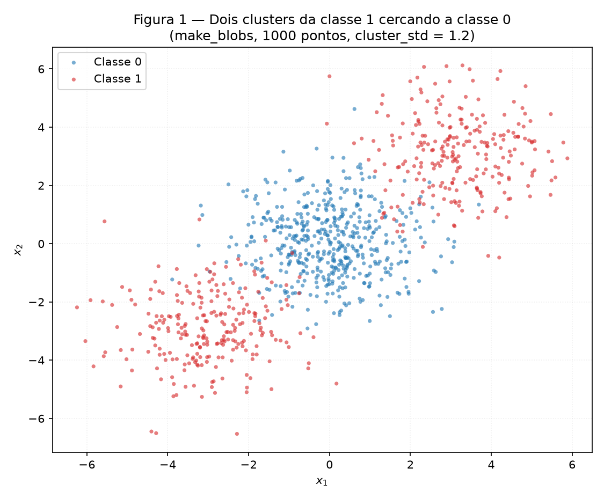
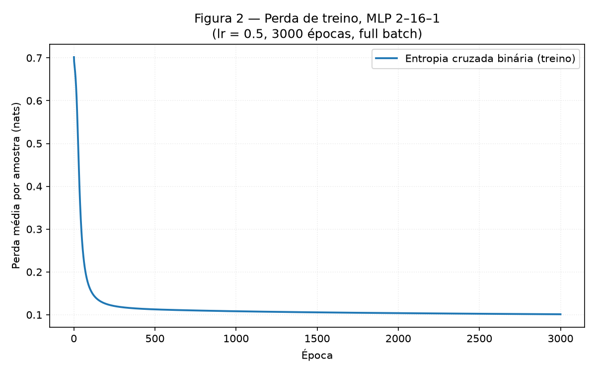
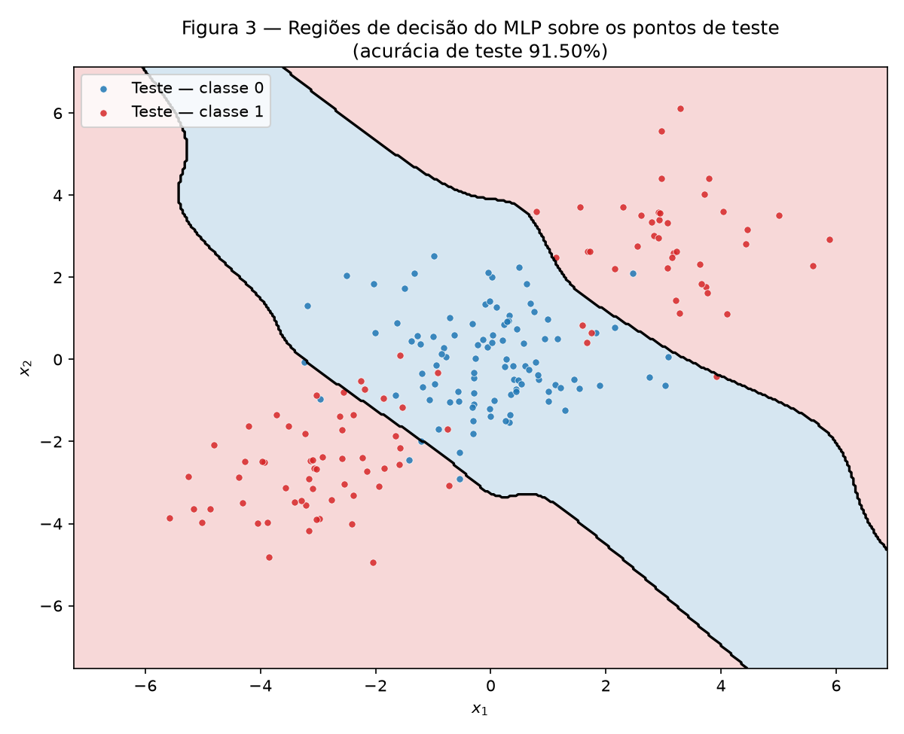
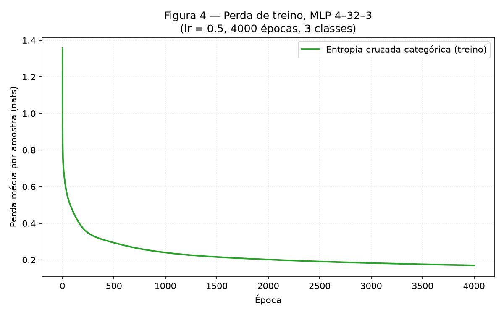
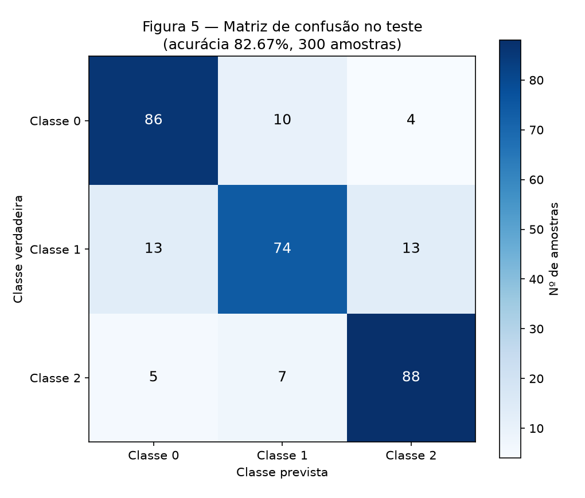
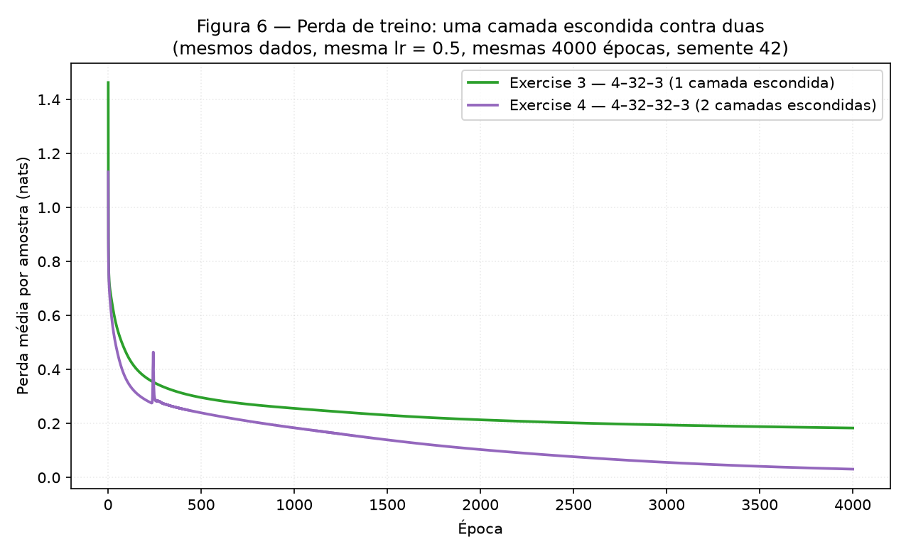

# 3. MLP

!!! abstract "Enunciado"

    [Exercises → MLP](https://insper.github.io/ann-dl/){:target='_blank'}

!!! info "Como reproduzir"

    ```bash
    python -m pip install -r requirements.txt
    python docs/exercises/mlp/code/run_all.py
    mkdocs build --strict
    ```

    `run_all.py` regenera as seis figuras em `figures/`, imprime todos os números
    no terminal e os grava em `results/metrics.json`. Leva cerca de um minuto.

**Estrutura do código.**

| Arquivo | Papel |
|---|---|
| `mlp.py` | O núcleo genérico: forward, perdas, backprop e update. Reutilizado nos Exercises 2, 3 e 4. |
| `exercise1_by_hand.py` | Os passos do Exercise 1, escritos um a um, sem autodiff. |
| `run_all.py` | Ponto de entrada único: dados, treinos, figuras e métricas. |

!!! warning "Nenhum autodiff, nenhuma biblioteca de rede"

    Ativações, perdas, **todos os gradientes** e o update são escritos à mão em
    NumPy. Não há TensorFlow, PyTorch nem `MLPClassifier`. O scikit-learn entra só
    onde o enunciado permite: `make_blobs`, `make_classification`,
    `train_test_split`, `confusion_matrix` e a `LogisticRegression` usada como
    *baseline* no Exercise 2 (e, para comparação, no Exercise 3).

    A semente da parte NumPy é criada uma vez, em `run_all.py`, como
    `rng = np.random.default_rng(42)`; os geradores do scikit-learn recebem
    `random_state=42`, que é a forma que essas APIs aceitam. A única exceção é o
    Exercise 4, que o próprio enunciado manda repetir com pelo menos três
    sementes — ali as inicializações usam 42, 43 e 44.

??? note "`mlp.py` — o núcleo reutilizado"

    ``` { .python .copy .select linenums='1' title="docs/exercises/mlp/code/mlp.py" }
    --8<-- "docs/exercises/mlp/code/mlp.py"
    ```

??? note "`exercise1_by_hand.py` — o passo manual do Exercise 1"

    ``` { .python .copy .select linenums='1' title="docs/exercises/mlp/code/exercise1_by_hand.py" }
    --8<-- "docs/exercises/mlp/code/exercise1_by_hand.py"
    ```

??? note "`run_all.py` — dados, treinos e figuras"

    ``` { .python .copy .select linenums='1' title="docs/exercises/mlp/code/run_all.py" }
    --8<-- "docs/exercises/mlp/code/run_all.py"
    ```

## Exercise 1

Rede com 2 entradas, 1 camada escondida de 2 neurônios e 1 saída, com $\tanh$ nas
duas camadas e perda $L = (y - \hat{y})^2$ sobre uma única amostra ($N = 1$).

| Parâmetro | Valor |
|---|---|
| Entrada e alvo | $\mathbf{x} = [0.5,\ -0.2]$, $y = 1.0$ |
| $\mathbf{W}^{(1)}$ | $\begin{bmatrix} 0.3 & -0.1 \\ 0.2 & 0.4 \end{bmatrix}$ |
| $\mathbf{b}^{(1)}$ | $[0.1,\ -0.2]$ |
| $\mathbf{W}^{(2)}$ | $[0.5,\ -0.3]$ |
| $b^{(2)}$ | $0.2$ |
| $\eta$ | $0.3$ |

Derivada usada o tempo todo: $\dfrac{d}{du}\tanh(u) = 1 - \tanh^2(u)$.

### A — Forward pass

**Pré-ativações da camada escondida**, $\mathbf{z}^{(1)} = \mathbf{W}^{(1)}\mathbf{x} + \mathbf{b}^{(1)}$:

$$
z^{(1)}_1 = (0.3)(0.5) + (-0.1)(-0.2) + 0.1 = 0.15 + 0.02 + 0.1 = \mathbf{0.270000}
$$

$$
z^{(1)}_2 = (0.2)(0.5) + (0.4)(-0.2) + (-0.2) = 0.10 - 0.08 - 0.20 = \mathbf{-0.180000}
$$

**Ativações da camada escondida**, $\mathbf{h}^{(1)} = \tanh(\mathbf{z}^{(1)})$:

$$
h^{(1)}_1 = \tanh(0.27) = \mathbf{0.263625},
\qquad
h^{(1)}_2 = \tanh(-0.18) = \mathbf{-0.178081}
$$

**Pré-ativação da saída**, $u^{(2)} = \mathbf{W}^{(2)}\mathbf{h}^{(1)} + b^{(2)}$:

$$
u^{(2)} = (0.5)(0.263625) + (-0.3)(-0.178081) + 0.2
= 0.131813 + 0.053424 + 0.2 = \mathbf{0.385237}
$$

**Saída e perda:**

$$
\hat{y} = \tanh(0.385237) = \mathbf{0.367247},
\qquad
L = (1 - 0.367247)^2 = (0.632753)^2 = \mathbf{0.400377}
$$

### B — Backward pass

**Começo da cadeia.** Com $L = (y - \hat{y})^2$:

$$
\frac{\partial L}{\partial \hat{y}} = -2\,(y - \hat{y}) = -2\,(1 - 0.367247) = \mathbf{-1.265507}
$$

**Atravessando a $\tanh$ da saída.** Como $\hat{y} = \tanh(u^{(2)})$, vale
$\partial\hat{y}/\partial u^{(2)} = 1 - \hat{y}^2 = 1 - 0.134870 = 0.865130$:

$$
\frac{\partial L}{\partial u^{(2)}}
= \frac{\partial L}{\partial \hat{y}}\,(1 - \hat{y}^2)
= (-1.265507)(0.865130) = \mathbf{-1.094828}
$$

**Camada de saída.** De $u^{(2)} = \sum_i W^{(2)}_i h^{(1)}_i + b^{(2)}$ saem
$\partial u^{(2)}/\partial W^{(2)}_i = h^{(1)}_i$ e $\partial u^{(2)}/\partial b^{(2)} = 1$:

$$
\frac{\partial L}{\partial \mathbf{W}^{(2)}}
= \frac{\partial L}{\partial u^{(2)}}\,\mathbf{h}^{(1)}
= (-1.094828)\,[0.263625,\ -0.178081]
= \mathbf{[-0.288624,\ 0.194968]}
$$

$$
\frac{\partial L}{\partial b^{(2)}} = \frac{\partial L}{\partial u^{(2)}} = \mathbf{-1.094828}
$$

**Propagando para trás.** De $\partial u^{(2)}/\partial h^{(1)}_i = W^{(2)}_i$:

$$
\frac{\partial L}{\partial \mathbf{h}^{(1)}}
= \frac{\partial L}{\partial u^{(2)}}\,\mathbf{W}^{(2)}
= (-1.094828)\,[0.5,\ -0.3]
= \mathbf{[-0.547414,\ 0.328448]}
$$

Atravessando a $\tanh$ da camada escondida, com
$1 - (h^{(1)})^2 = [0.930502,\ 0.968287]$:

$$
\frac{\partial L}{\partial \mathbf{z}^{(1)}}
= \frac{\partial L}{\partial \mathbf{h}^{(1)}} \odot \left(1 - (\mathbf{h}^{(1)})^2\right)
= [(-0.547414)(0.930502),\ (0.328448)(0.968287)]
= \mathbf{[-0.509370,\ 0.318032]}
$$

**Camada escondida.** De $z^{(1)}_i = \sum_j W^{(1)}_{ij} x_j + b^{(1)}_i$ saem
$\partial z^{(1)}_i/\partial W^{(1)}_{ij} = x_j$ e $\partial z^{(1)}_i/\partial b^{(1)}_i = 1$,
ou seja, o gradiente dos pesos é o produto externo $\frac{\partial L}{\partial \mathbf{z}^{(1)}} \mathbf{x}^\top$:

$$
\frac{\partial L}{\partial \mathbf{W}^{(1)}}
=
\begin{bmatrix}
(-0.509370)(0.5) & (-0.509370)(-0.2)\\
(0.318032)(0.5) & (0.318032)(-0.2)
\end{bmatrix}
=
\mathbf{\begin{bmatrix} -0.254685 & 0.101874\\ 0.159016 & -0.063606 \end{bmatrix}}
$$

$$
\frac{\partial L}{\partial \mathbf{b}^{(1)}}
= \frac{\partial L}{\partial \mathbf{z}^{(1)}}
= \mathbf{[-0.509370,\ 0.318032]}
$$

### C — Parameter update

Com $\eta = 0.3$ e $\theta \leftarrow \theta - \eta\,\partial L/\partial\theta$:

| Parâmetro | Valor antigo | Gradiente | **Valor atualizado** |
|---|---|---|---|
| $W^{(1)}_{11}$ | $0.300000$ | $-0.254685$ | $\mathbf{0.376405}$ |
| $W^{(1)}_{12}$ | $-0.100000$ | $0.101874$ | $\mathbf{-0.130562}$ |
| $W^{(1)}_{21}$ | $0.200000$ | $0.159016$ | $\mathbf{0.152295}$ |
| $W^{(1)}_{22}$ | $0.400000$ | $-0.063606$ | $\mathbf{0.419082}$ |
| $b^{(1)}_1$ | $0.100000$ | $-0.509370$ | $\mathbf{0.252811}$ |
| $b^{(1)}_2$ | $-0.200000$ | $0.318032$ | $\mathbf{-0.295410}$ |
| $W^{(2)}_1$ | $0.500000$ | $-0.288624$ | $\mathbf{0.586587}$ |
| $W^{(2)}_2$ | $-0.300000$ | $0.194968$ | $\mathbf{-0.358490}$ |
| $b^{(2)}$ | $0.200000$ | $-1.094828$ | $\mathbf{0.528448}$ |

(São oito parâmetros treináveis mais $b^{(2)}$ — a tabela lista os nove valores
escalares: os 4 de $\mathbf{W}^{(1)}$, os 2 de $\mathbf{b}^{(1)}$, os 2 de
$\mathbf{W}^{(2)}$ e $b^{(2)}$.)

**A perda sobe ou desce no segundo forward?** **Desce**, e a razão é estrutural, não
empírica. Todos os gradientes foram calculados *neste* ponto, e a descida de
gradiente move cada parâmetro na direção $-\partial L/\partial\theta$. Para um passo
suficientemente pequeno, a variação da perda em primeira ordem é

$$
\Delta L \approx -\eta \left\lVert \nabla_\theta L \right\rVert^2 \le 0,
$$

ou seja, negativa a menos que o gradiente seja nulo. O risco seria $\eta$ grande
demais, que ultrapassaria o mínimo na direção do gradiente; aqui $\eta = 0.3$ é
modesto. No conteúdo: $\hat{y} = 0.367247$ está abaixo do alvo $y = 1$, e **todos os
nove parâmetros se moveram no sentido de aumentar $\hat{y}$** — repare que
$b^{(2)}$ saltou de $0.2$ para $0.528448$, empurrando a pré-ativação para cima.

Rodando de fato o segundo forward com os parâmetros atualizados:

$$
\mathbf{z}^{(1)} = [0.467126,\ -0.303079],\quad
\mathbf{h}^{(1)} = [0.435874,\ -0.294127],\quad
u^{(2)} = 0.889568
$$

$$
\hat{y} = 0.711181, \qquad L = \mathbf{0.083417}
$$

A perda caiu de $0.400377$ para $0.083417$ — uma queda de $0.316960$, ou **79.2 %**
em um único passo.

## Exercise 2

### A — Generate the data

**Abordagem.** `make_blobs` com os parâmetros exatos do enunciado: centros
$[0,0]$, $[3,3]$ e $[-3,-3]$, `n_samples=[500, 250, 250]`, `cluster_std=1.2`,
`random_state=42`. Depois, `y = (c > 0).astype(int)` — o cluster central vira a
classe 0 e **os dois clusters das pontas viram, juntos, a classe 1**. Split 80/20
estratificado com `random_state=42`: 800 treino, 200 teste.


/// caption
**Figura 1** — Os 1000 pontos coloridos por $y$. A classe 1 (vermelho) ocupa duas
regiões em lados **opostos** da classe 0 (azul).
///

### B — Establish the baseline

Uma `LogisticRegression` ajustada no treino — a fronteira linear de referência,
não o modelo deste exercício — atinge **47.50 %** de acurácia no teste.

Está **abaixo dos 50 %** que se obteria jogando uma moeda. O item D explica.

### C — Implement the MLP

**Abordagem.** Rede escrita do zero em `mlp.py`. `layer_sizes` é argumento, não
constante no código — é o que permite reaproveitar exatamente o mesmo núcleo nos
Exercises 3 e 4.

- **Forward:** camadas escondidas com $\mathbf{a} = \tanh(\mathbf{a}_{\text{prev}}\mathbf{W} + \mathbf{b})$; saída com sigmoide.
- **Perda:** entropia cruzada binária, média por amostra.
- **Backward:** todos os gradientes derivados à mão (ver a derivação no Exercise 3 B, que cobre os dois casos).
- **Update:** descida de gradiente, *full batch*.

| Item | Valor |
|---|---|
| Arquitetura | **2–16–1** (uma camada escondida de 16 neurônios, $\tanh$; saída sigmoide) |
| Parâmetros treináveis | 65 |
| Taxa de aprendizado | 0.5 |
| Épocas | 3000 (*full batch*) |
| Perda de treino | 0.701723 → **0.101149** |
| Acurácia de treino | 96.25 % |
| **Acurácia de teste** | **91.50 %** |


/// caption
**Figura 2** — Entropia cruzada binária por época. A perda cai de 0.7017 para
0.1606 nas **primeiras 100 épocas** — 90 % de toda a queda —, quando a rede acha a
faixa central; as 2900 épocas restantes apenas refinam a fronteira, levando a perda
a 0.1011.
///


/// caption
**Figura 3** — A rede avaliada numa malha de 400 × 400 pontos, com as duas regiões
sombreadas e os pontos de teste por cima. A região da classe 0 é uma **faixa
diagonal**; a classe 1 ocupa os dois cantos.
///

### D — Analysis

**Por que o baseline linear fica abaixo de 50 % enquanto o MLP passa de 90 %.**

Olhe a Figura 3. A região que a rede atribui à classe 0 é uma **faixa (uma tira
diagonal) limitada por duas fronteiras aproximadamente paralelas**, e a classe 1
ocupa os dois semiplanos que sobram, um de cada lado da faixa. Essa é a forma que a
geometria dos dados exige: a classe 1 tem dois clusters, em $[3,3]$ e $[-3,-3]$, e
eles estão em **lados opostos** do cluster da classe 0, centrado na origem.

Uma única reta não consegue produzir essa forma, e a razão é exata: uma reta divide
o plano em dois semiplanos, cada um **convexo e conexo**. Mas a região da classe 1
que os dados pedem é a **união de dois conjuntos disjuntos**, separados pela faixa
da classe 0 no meio. Nenhum semiplano é a união de dois pedaços desconexos. É
preciso de pelo menos **duas** fronteiras lineares — uma de cada lado da faixa — e é
exatamente isso que os 16 neurônios escondidos fornecem: cada neurônio contribui
com uma fronteira linear, e a camada de saída as combina.

**Por que abaixo de 50 %, e não exatamente 50 %.** Este é o detalhe que torna o
resultado interessante, e ele exige separar duas coisas: o que uma reta *poderia*
fazer e o que a regressão logística *faz*.

Uma busca exaustiva sobre todas as retas — varrendo 721 ângulos e todos os
deslocamentos possíveis — mostra que **a melhor reta alcança 75.50 %** no conjunto
de teste. Faz sentido: ela isola um dos clusters da classe 1 e chama todo o resto
de classe 0, acertando 250 + 500 de 1000 pontos. Então o teto do linear é 75 %, não
50 %.

A regressão logística, porém, **não otimiza acurácia** — ela minimiza a perda
logística. E os dois clusters da classe 1 estão em posições **simétricas** em torno
da origem ($[3,3]$ e $[-3,-3]$): cada um puxa a fronteira para um lado, e os
puxões se cancelam. O resultado medido é uma fronteira praticamente **passando pela
origem**: a distância dela até a origem é de apenas **0.1044**, ou seja, ela corta o
cluster da classe 0 bem no meio. A consequência aparece nos acertos por classe:

| Classe | Acertos do baseline linear |
|---|---:|
| 0 (cluster central) | 53.40 % |
| 1 (dois clusters) | 50.00 % |

Ela divide a classe 0 quase ao meio e a classe 1 exatamente ao meio — um cluster de
cada lado. Daí os **47.50 %**, abaixo do acaso. A lição é que simetria não deixa o
classificador linear apenas ruim: deixa-o **pior que uma moeda**, porque a perda que
ele minimiza o leva ativamente para o pior lugar possível da família de retas,
distante dos 75.50 % que a melhor reta atingiria.

## Exercise 3

### A — Generate the data

`make_classification` com os parâmetros exatos do enunciado: 1500 amostras,
4 features **todas informativas** (`n_redundant=0`, `n_repeated=0`), 3 classes,
**2 clusters por classe**, `class_sep=1.0`, `random_state=42`. Split 80/20
estratificado com a mesma semente: 1200 treino, 300 teste.

O ponto estrutural: são **6 clusters** (3 classes × 2) espalhados num espaço de
4 dimensões.

### B — Adapt the network

O mesmo núcleo do Exercise 2, com três mudanças que são **argumentos, não
estrutura**: a saída passa a ter 3 unidades, a não linearidade final passa a ser
softmax, e a perda passa a ser entropia cruzada categórica.

$$
p_k = \frac{e^{u_k}}{\sum_{j=1}^{3} e^{u_j}},
\qquad
L = -\sum_{k=1}^{3} y_k \log p_k
$$

#### Derivação de $\partial L / \partial u$

Esta é a conta que permite que o *backward* seja literalmente o mesmo código nos
dois exercícios. Primeiro, a derivada do softmax:

$$
\frac{\partial p_k}{\partial u_i} = p_k\,(\delta_{ki} - p_i),
$$

onde $\delta_{ki}$ vale 1 se $k = i$ e 0 caso contrário. Agora a regra da cadeia,
somando sobre todas as saídas (pois $u_i$ afeta **todas** as $p_k$ pelo
denominador compartilhado):

$$
\frac{\partial L}{\partial u_i}
= \sum_{k} \frac{\partial L}{\partial p_k}\frac{\partial p_k}{\partial u_i}
= \sum_{k} \left(-\frac{y_k}{p_k}\right) p_k\,(\delta_{ki} - p_i)
= -\sum_{k} y_k\,(\delta_{ki} - p_i)
$$

Abrindo a soma, o termo com $\delta_{ki}$ sobrevive só em $k = i$:

$$
\frac{\partial L}{\partial u_i}
= -y_i + p_i \sum_{k} y_k
= -y_i + p_i \cdot 1
= \boxed{\,p_i - y_i\,}
$$

usando que $\sum_k y_k = 1$ num vetor one-hot. **O $p_k$ do denominador cancela com
o $p_k$ da derivada do softmax** — é daí que vem a simplicidade famosa do resultado.

E o caso binário dá a mesma forma. Com $p = \sigma(u)$ e
$L = -[y\log p + (1-y)\log(1-p)]$:

$$
\frac{\partial L}{\partial p} = \frac{p - y}{p\,(1-p)},
\qquad
\frac{\partial p}{\partial u} = p\,(1-p)
\;\;\Longrightarrow\;\;
\frac{\partial L}{\partial u} = p - y
$$

**Por isso o `backward()` de `mlp.py` não precisa saber qual perda está em uso:**
ele começa de `delta = (probs - Y) / N` e segue idêntico. A reutilização verbatim
que o item extra pede não é um truque de organização — ela é consequência direta
desta identidade.

### C — Train and evaluate

| Item | Valor |
|---|---|
| Arquitetura | **4–32–3** (uma camada escondida de 32 neurônios, $\tanh$; saída softmax) |
| Parâmetros treináveis | 259 |
| Taxa de aprendizado | 0.5 |
| Épocas | 4000 (*full batch*) |
| Perda de treino final | 0.176446 |
| Acurácia de treino | 93.75 % |
| **Acurácia de teste** | **82.67 %** |

!!! note "Honestidade sobre a faixa esperada"

    O enunciado antecipa "aproximadamente 83–86 %". Esta execução deu **82.67 %**,
    pouco abaixo da faixa. O número não foi ajustado para entrar nela. A mesma
    arquitetura, repetida com três sementes no Exercise 4, dá **83.78 %** em média
    — ou seja, 82.67 % é a variação normal de uma inicialização específica, não um
    defeito. O enunciado diz explicitamente que o valor da acurácia não é avaliado.


/// caption
**Figura 4** — Entropia cruzada categórica por época.
///


/// caption
**Figura 5** — Matriz de confusão no conjunto de teste (300 amostras).
///

A matriz, em números:

| | Prevista 0 | Prevista 1 | Prevista 2 |
|---|---:|---:|---:|
| **Verdadeira 0** | **86** | 10 | 4 |
| **Verdadeira 1** | 13 | **74** | 13 |
| **Verdadeira 2** | 5 | 7 | **88** |

### D — Analysis

**Qual par a rede mais confunde.** O par **classe 0 ↔ classe 1**, com **23 erros**
(10 de 0 para 1, mais 13 de 1 para 0) — **44.2 % dos 52 erros** do teste. Para
comparar, o par 1 ↔ 2 soma 20 erros e o par 0 ↔ 2 apenas 9.

| Par | Erros | % dos 52 erros |
|---|---:|---:|
| **0 ↔ 1** | **23** | **44.2 %** |
| 1 ↔ 2 | 20 | 38.5 % |
| 0 ↔ 2 | 9 | 17.3 % |

**Explicação a partir da estrutura dos dados.** O `make_classification` colocou
**6 clusters** — 2 por classe — nos vértices de um hipercubo em 4 dimensões, com
`class_sep=1.0`, uma separação modesta. Duas consequências:

1. **Cada classe é desconexa.** Como cada classe é a união de dois clusters que
   podem cair em cantos distantes do hipercubo, a região de decisão de uma classe
   não é um bloco único. A rede precisa aprender duas ilhas por classe — é o mesmo
   problema do Exercise 2, agora em 4D e com três rótulos.
2. **Com 6 clusters e separação 1.0, alguns ficam vizinhos.** Os 6 centros são
   atribuídos às classes sem nenhuma garantia de que clusters da mesma classe
   fiquem próximos, ou de que clusters de classes diferentes fiquem longe. Quando
   um cluster da classe 0 cai ao lado de um da classe 1, as caudas gaussianas se
   interpenetram e produzem erro **nos dois sentidos** — que é exatamente a
   assinatura observada: 10 numa direção, 13 na outra, quase simétrico. Um erro
   causado por fronteira mal posicionada seria assimétrico; esse é causado por
   sobreposição real.

A classe 1 é também a que mais erra no total (26 dos 52): sua linha da matriz é a
única com erros distribuídos quase igualmente para os dois lados (13 e 13),
sugerindo que seus dois clusters estão encaixados entre os das outras duas classes.

**O que a camada escondida acrescentou.** A `LogisticRegression` nesta mesma base
atinge **66.33 %** no teste. O MLP chega a **82.67 %** — um ganho de
**+16.34 pontos percentuais**, ou uma redução de 48.5 % na taxa de erro
(de 33.67 % para 17.33 %).

O baseline linear vai relativamente bem (66 %, bem acima dos 33 % do acaso) porque,
com 4 dimensões informativas, há bastante sinal marginal: hiperplanos capturam a
tendência geral de cada classe. O que ele **não** consegue é a mesma coisa do
Exercise 2 — a região de cada classe é desconexa, e um classificador linear
multiclasse só produz regiões **convexas** (interseções de semiplanos). Os 16
pontos percentuais extras são precisamente o preço dessa desconexão, e é isso que a
camada escondida compra.

## Exercise 4

### A — Train the deeper network

Mesmos dados do Exercise 3, mesmo orçamento (**4000 épocas**), mesma taxa
(**lr = 0.5**), mesma função de perda. **A única coisa que muda é a profundidade.**

| | Exercise 3 | Exercise 4 |
|---|---|---|
| Arquitetura | 4–32–3 | **4–32–32–3** |
| Camadas escondidas | 1 | **2** |
| Parâmetros | 259 | **1315** (5.1 ×) |

### B — Compare

Cada configuração foi treinada **três vezes**, com sementes de inicialização 42,
43 e 44, e o que se reporta é a média — para comparar modelos, não sorte de
inicialização.

| | hidden layers | parameters | final train loss | test accuracy |
|---|---:|---:|---:|---:|
| **Exercise 3** | 1 | 259 | 0.176446 | **83.78 %** |
| **Exercise 4** | 2 | 1315 | **0.032905** | 82.78 % |

Por semente:

| Semente | 4–32–3 (rasa) | 4–32–32–3 (profunda) |
|---|---:|---:|
| 42 | 84.33 % | 83.00 % |
| 43 | 83.67 % | 82.67 % |
| 44 | 83.33 % | 82.67 % |
| **Média** | **83.78 %** (± 0.51) | **82.78 %** (± 0.19) |

**Diferença média (profunda − rasa): $-1.00$ ponto percentual.** A rede mais funda
é consistentemente pior — perdeu nas três sementes, e a diferença é maior que o
desvio-padrão de qualquer uma das duas.


/// caption
**Figura 6** — Perda de treino das duas redes nos mesmos eixos, mesma semente,
mesmo orçamento. A rede profunda desce bem mais fundo — e é justamente esse o
problema.
///

### C — Analysis

**A profundidade não ajudou: ela custou 1.00 ponto percentual.** É o resultado
esperado, e vale examinar por quê em vez de ajustar até que a profundidade vença.

**A perda de treino e a acurácia de teste contam histórias opostas.** Este é o
ponto central da Figura 6, e ele fica explícito quando se olha o treino ao lado do
teste:

| | Perda de treino | Acurácia de treino | Acurácia de teste | Distância treino − teste |
|---|---:|---:|---:|---:|
| 4–32–3 | 0.176446 | 94.25 % | 83.78 % | 10.47 pp |
| 4–32–32–3 | 0.032905 | 99.33 % | 82.78 % | **16.55 pp** |

A rede profunda ajusta o treino **5.4 vezes melhor** em perda e chega a 99.33 % de
acurácia de treino — quase memorização. E ainda assim generaliza pior. A capacidade
extra não foi usada para descobrir estrutura; foi usada para **decorar as 1200
amostras de treino**, ruído incluído. Quem olhasse apenas a Figura 6 concluiria que
a rede profunda é melhor, o que é um bom lembrete de que curva de treino não é
medida de generalização.

**Por que 1 camada já basta aqui.** Os dados têm 6 clusters aproximadamente
gaussianos em 4 dimensões. A fronteira necessária é uma superfície que envolve
algumas regiões convexas — complexa o bastante para derrotar um modelo linear
(os 66.33 % do baseline provam isso), mas **rasa em termos de composição**. Pelo
teorema da aproximação universal, uma camada escondida com largura suficiente já
representa qualquer fronteira dessas; e 32 neurônios em 4D são capazes de carregar
bem mais do que 6 blobs exigem. A segunda camada não tem o que acrescentar em
**representação** — a primeira já é expressiva o suficiente.

**O que a segunda camada custa.** Dois preços, ambos visíveis nos números:

1. **Estatístico.** 1315 parâmetros contra 259, para 1200 amostras de treino. A
   rede profunda tem **mais parâmetros do que exemplos**. Sem regularização, a
   folga vira ajuste a ruído: os 16.55 pontos de distância entre treino e teste.
2. **De otimização.** Gradientes atravessam mais uma $\tanh$ antes de chegar à
   primeira camada, e cada passagem multiplica por $1 - \tanh^2 \le 1$ — o sinal
   que chega às camadas iniciais encolhe. Com o mesmo orçamento e a mesma taxa, a
   rede profunda não está resolvendo o mesmo problema de otimização com mais
   ferramentas; está resolvendo um problema pior condicionado.

**Que dado premiaria a profundidade.** Dados com **estrutura composicional e
hierárquica**, em que features úteis se constroem a partir de features úteis mais
simples. Imagens são o exemplo canônico: pixels → bordas → texturas → partes →
objetos, e cada nível reaproveita o anterior. Uma rede rasa teria de representar
"objeto" diretamente a partir de pixels, o que exige largura exponencialmente
maior que a profundidade equivalente. O mesmo vale para linguagem (caracteres →
palavras → sintagmas → sentido) e para funções que são composições de muitos
passos. Aqui, ao contrário, as 4 features **já são** as variáveis informativas —
não existe hierarquia a explorar, e a profundidade só adiciona parâmetros.

Vale a precisão final: o resultado é que a profundidade não ajuda **neste
conjunto**, com **este orçamento** e **sem regularização**. Não é uma afirmação
sobre profundidade em geral.

## Results summary

| # | Quantity | Value |
|---:|---|---|
| 1 | Ex. 1 — \(\mathbf{z}^{(1)}\) and \(\mathbf{h}^{(1)}\) | \(\mathbf{z}^{(1)} = [0.270000,\ -0.180000]\); \(\mathbf{h}^{(1)} = [0.263625,\ -0.178081]\) |
| 2 | Ex. 1 — \(u^{(2)}\), \(\hat{y}\) and \(L\) | \(u^{(2)} = 0.385237\); \(\hat{y} = 0.367247\); \(L = 0.400377\) |
| 3 | Ex. 1 — the eight updated parameters | \(\mathbf{W}^{(1)} = [[0.376405,\ -0.130562],\ [0.152295,\ 0.419082]]\); \(\mathbf{b}^{(1)} = [0.252811,\ -0.295410]\); \(\mathbf{W}^{(2)} = [0.586587,\ -0.358490]\); \(b^{(2)} = 0.528448\) |
| 4 | Ex. 2 — linear baseline test accuracy | 47.50 % (abaixo do acaso) |
| 5 | Ex. 2 — architecture and test accuracy | 2–16–1 (65 parâmetros, lr 0.5, 3000 épocas) — **91.50 %** |
| 6 | Ex. 3 — architecture and test accuracy | 4–32–3 (259 parâmetros, lr 0.5, 4000 épocas) — **82.67 %** (baseline linear: 66.33 %) |
| 7 | Ex. 3 — most-confused class pair | classes **0 e 1**, com 23 erros (10 de 0→1, 13 de 1→0) = 44.2 % dos 52 erros |
| 8 | Ex. 4 — architecture and test accuracy | 4–32–32–3 (1315 parâmetros, mesmo lr e mesmas épocas) — **82.78 %** (média de 3 sementes) |
| 9 | Ex. 4 — accuracy difference against Ex. 3 (mean over ≥ 3 seeds) | **−1.00 ponto percentual** (82.78 % contra 83.78 %; sementes 42, 43, 44 — a rede profunda perdeu nas três) |
