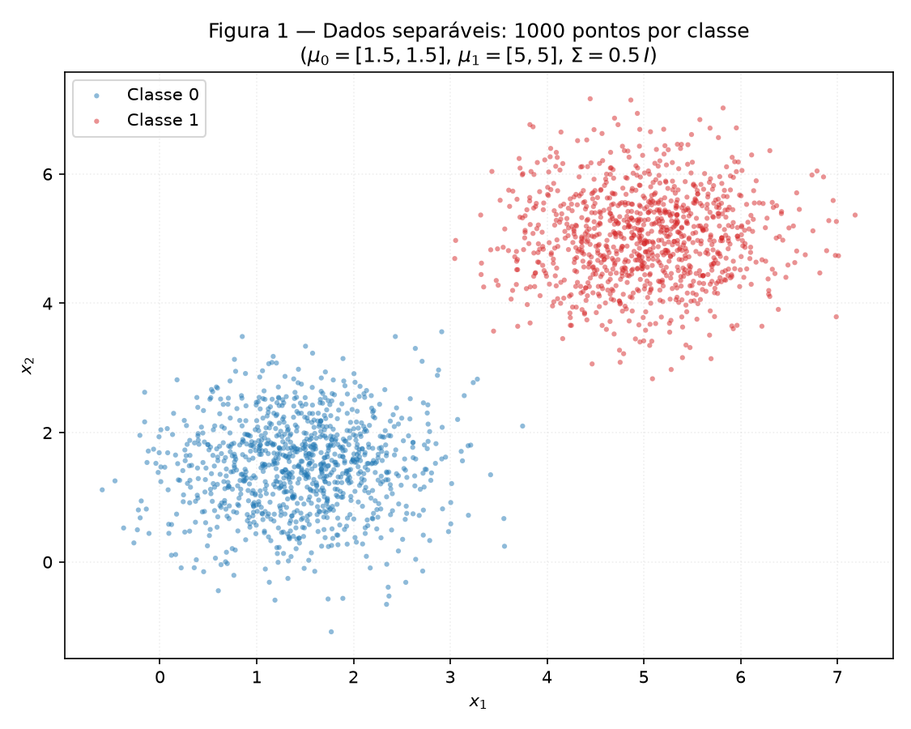
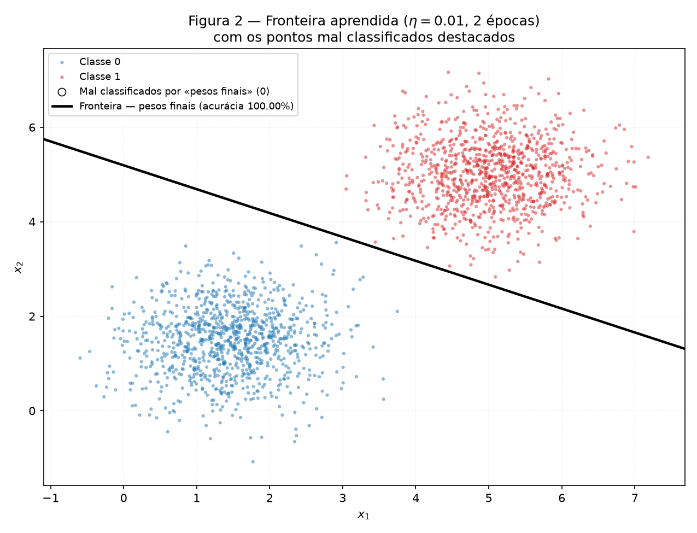
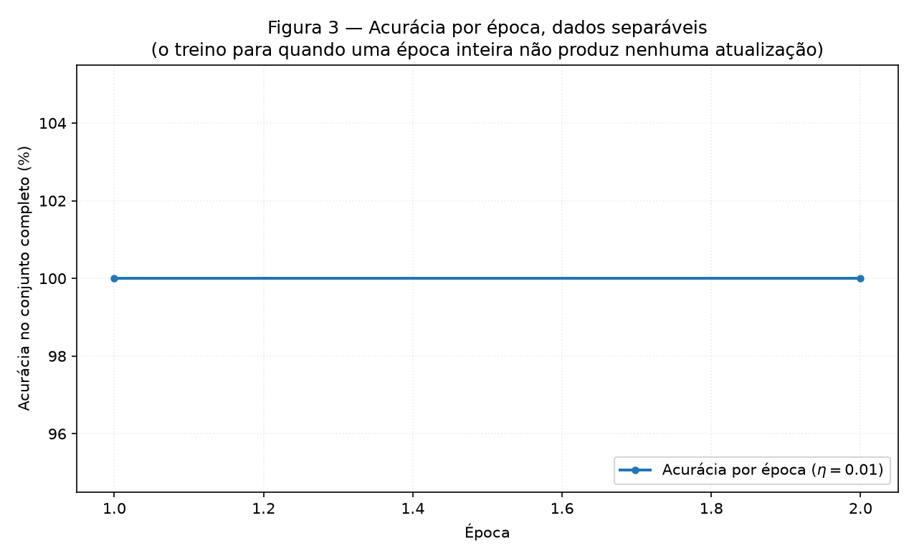
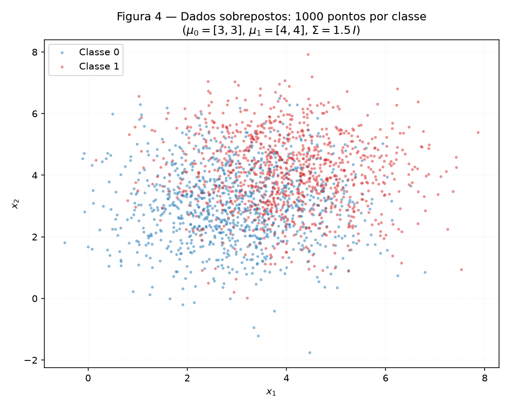
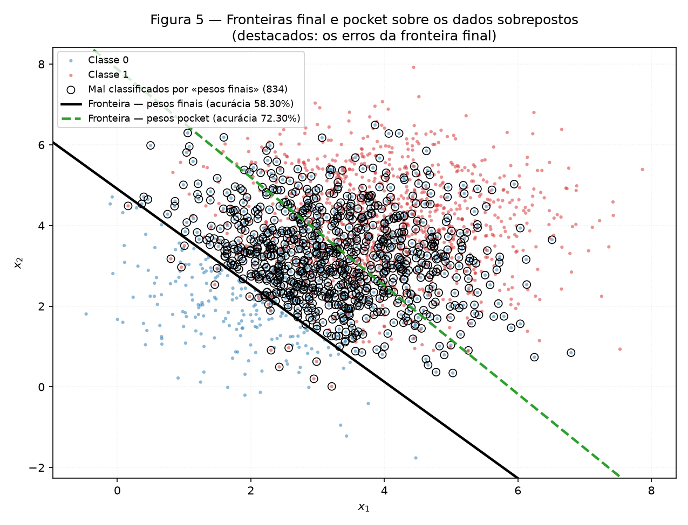
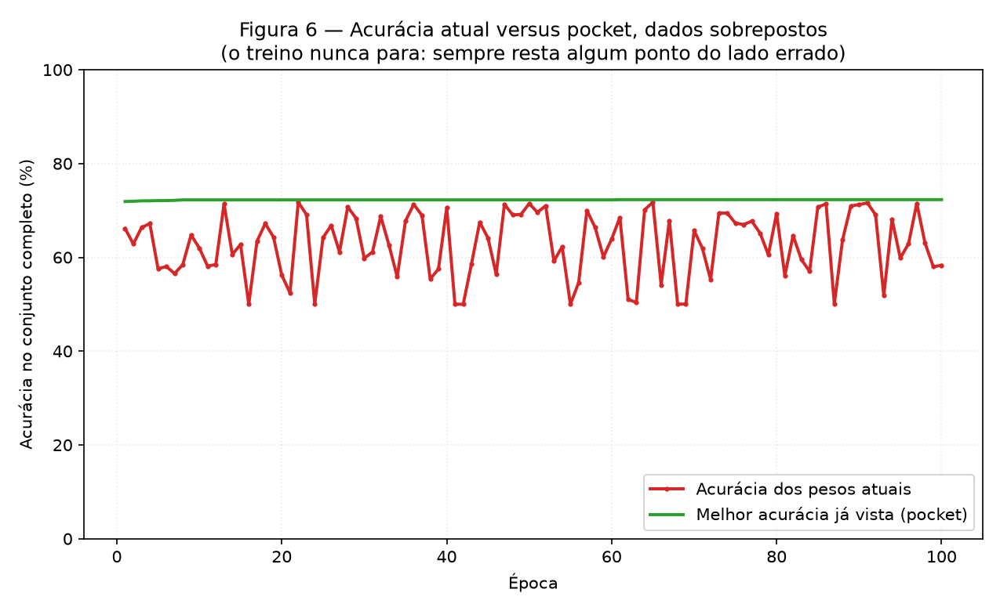

# 2. Perceptron

!!! abstract "Enunciado"

    [Exercises → Perceptron](https://insper.github.io/ann-dl/){:target='_blank'}

!!! info "Como reproduzir"

    Todos os números deste relatório saem de uma única execução. A partir da raiz
    do repositório:

    ```bash
    python -m pip install -r requirements.txt
    python docs/exercises/perceptron/code/run_all.py
    mkdocs build --strict
    ```

    `run_all.py` regenera as seis figuras em `figures/`, imprime todos os números
    no terminal e os grava em `results/metrics.json`.

**Estrutura do código.** O perceptron vive em
[`code/perceptron.py`](https://github.com/giovannyjvr/exercicio-redes/blob/main/docs/exercises/perceptron/code/perceptron.py)
e é incluído neste relatório pelo próprio arquivo, via `--8<--`.

| Arquivo | Papel |
|---|---|
| `perceptron.py` | A implementação do zero: `step`, `predict`, regra de atualização e laço de treino. |
| `run_all.py` | Ponto de entrada único: gera os dados, treina, produz as seis figuras e salva as métricas. |

!!! warning "Nenhuma biblioteca fornece o modelo"

    A ativação, a predição, a regra de atualização e o laço de treino são escritos
    à mão. O NumPy entra apenas como álgebra linear (produto escalar, permutação,
    amostragem das gaussianas). **Não há `sklearn` neste exercício** — nem
    `Perceptron`, nem `SGDClassifier`, nem qualquer `fit`.

    A semente é criada uma única vez, em `run_all.py`, como
    `rng = np.random.default_rng(42)`, e o mesmo objeto é passado à geração dos
    dados e a cada treino, sempre na mesma ordem.

??? note "`perceptron.py` — a implementação"

    ``` { .python .copy .select linenums='1' title="docs/exercises/perceptron/code/perceptron.py" }
    --8<-- "docs/exercises/perceptron/code/perceptron.py"
    ```

??? note "`run_all.py` — geração dos dados, treino e figuras"

    ``` { .python .copy .select linenums='1' title="docs/exercises/perceptron/code/run_all.py" }
    --8<-- "docs/exercises/perceptron/code/run_all.py"
    ```

## Exercise 1

### A — Generate the data

**Abordagem.** Duas classes de pontos 2D, 1000 amostras cada, de normais
multivariadas com os parâmetros do enunciado:

| Classe | Média | Covariância |
|---|---|---|
| 0 | $[1.5,\ 1.5]$ | $[[0.5,\ 0],\ [0,\ 0.5]]$ |
| 1 | $[5,\ 5]$ | $[[0.5,\ 0],\ [0,\ 0.5]]$ |

A distância entre as médias é $\lVert [5,5] - [1.5,1.5] \rVert = 4.9497$, contra
um desvio-padrão de $\sqrt{0.5} = 0.7071$ por eixo — cerca de **7 desvios**. As
nuvens ficam bem separadas.


/// caption
**Figura 1** — Os 2000 pontos, uma cor por classe. As nuvens não se tocam.
///

*Código: `run_all.py` → `generate()` e `figure_scatter()`.*

### B — Implement the perceptron

**Abordagem.** Implementação do zero, em `perceptron.py`, reutilizada sem
alteração no Exercise 2.

- **Predição.** $\hat{y} = \text{step}(\mathbf{w}\cdot\mathbf{x} + b)$, com
  $\text{step}(z) = 1$ se $z \geq 0$ e $0$ caso contrário.
- **Atualização.** Para cada amostra $(\mathbf{x}, y)$:

$$
\mathbf{w} \leftarrow \mathbf{w} + \eta\,(y - \hat{y})\,\mathbf{x},
\qquad
b \leftarrow b + \eta\,(y - \hat{y})
$$

- **Inicialização.** $\mathbf{w} \sim$ `rng.normal(0, 0.01, size=2)` e $b = 0$.
- **Taxa de aprendizado.** $\eta = 0.01$.
- **Parada.** Quando uma passagem completa não produz nenhuma atualização, ou ao
  atingir 100 épocas. A acurácia sobre o conjunto completo é registrada ao fim de
  cada época.

!!! note "Por que não $\mathbf{w} \leftarrow \mathbf{w} + \eta\,y\,\mathbf{x}$"

    Essa forma pertence à convenção $y \in \{-1, +1\}$. Com rótulos $0/1$ ela
    nunca atualizaria na classe 0 — o termo $y\mathbf{x}$ seria sempre nulo — e o
    perceptron jamais corrigiria um falso positivo. O fator $(y - \hat{y})$ vale
    $0$ quando a predição está certa (amostras corretas não geram atualização) e
    $\pm 1$ nos dois tipos de engano, que é exatamente o comportamento desejado.

**Uma escolha de implementação a declarar:** os dados são gerados agrupados por
classe (1000 da classe 0, depois 1000 da classe 1). Percorrê-los nessa ordem faria
o perceptron ver uma classe inteira antes da outra, o que distorce o treino. O laço
**embaralha a cada época** com `rng.permutation`, usando o mesmo gerador — continua
inteiramente reprodutível.

### C — Train and measure

**Resultados com $\eta = 0.01$:**

| Quantidade | Valor |
|---|---|
| $\mathbf{w}$ final | $[0.007782,\ 0.015401]$ |
| $b$ final | $-0.080000$ |
| Épocas até convergir | **2** |
| Acurácia final | **100.00 %** (2000 de 2000) |
| Atualizações por época | época 1: **20**; época 2: **0** |

O treino parou por convergência, não por limite de épocas: a segunda passagem
percorreu os 2000 pontos sem precisar de uma única correção.


/// caption
**Figura 2** — A fronteira $\mathbf{w}\cdot\mathbf{x} + b = 0$ sobre os dados. Não
há nenhum ponto mal classificado para destacar — o contador na legenda marca 0.
///


/// caption
**Figura 3** — Acurácia por época. Já ao fim da primeira época, depois das 20
correções, a acurácia é 100 %; a segunda época apenas confirma que nada mais muda.
///

*Código: `perceptron.py` → `train()`; `run_all.py` → `figure_boundary()` e
`figure_accuracy()`.*

### D — Analysis

#### Por que dados separáveis convergem rápido

A resposta está na própria regra de atualização: **o fator $(y - \hat{y})$ é zero
para toda amostra classificada corretamente**. Uma amostra certa não move
$\mathbf{w}$ nem $b$ — ela é efetivamente ignorada. Só os erros empurram a
fronteira, e cada empurrão a move na direção que corrige aquele erro específico.

A consequência é que **o número de atualizações por época mede quanto trabalho
resta**, e em dados separáveis ele desce a zero rapidamente. Foi o que aconteceu:

| Época | Atualizações | Acurácia ao fim da época |
|---:|---:|---:|
| 1 | 20 | 100.00 % |
| 2 | **0** | 100.00 % |

Como existe um hiperplano que acerta todos os pontos, há um conjunto de pesos em
que nenhuma amostra gera erro — e, atingido esse conjunto, o laço vira um ponto
fixo: zero atualizações, zero movimento, parada. É isso que o teorema de
convergência do perceptron garante para dados linearmente separáveis.

#### O que $\eta$ controla — a comparação $\eta = 0.01$ contra $\eta = 1.0$

Mesmo treino, mesma inicialização, mesma ordem de embaralhamento; só $\eta$ muda.

| | $\eta = 0.01$ | $\eta = 1.0$ |
|---|---|---|
| $\mathbf{w}$ final | $[0.007782,\ 0.015401]$ | $[5.357647,\ 5.551333]$ |
| $b$ final | $-0.080000$ | $-36.000000$ |
| Épocas | **2** | **5** |
| Acurácia final | **100.00 %** | **100.00 %** |
| $\lVert\mathbf{w}\rVert$ | 0.017255 | 7.715029 |
| Direção $\mathbf{w}/\lVert\mathbf{w}\rVert$ | $[0.450973,\ 0.892538]$ | $[0.694443,\ 0.719548]$ |
| Atualizações por época | $[20,\ 0]$ | $[71,\ 3,\ 21,\ 11,\ 0]$ |

As duas corridas chegam a 100 %, mas **por fronteiras diferentes**: o ângulo entre
as duas direções é de **17.1767°**.

O enunciado dá a chave: cada atualização soma $\eta\mathbf{x}$ a pesos que começaram
com magnitude $\approx 0.01$. Portanto **$\eta$ controla o peso relativo entre a
inicialização aleatória e as correções acumuladas**:

Nestes dados $\lVert\mathbf{x}\rVert$ vale **4.6543** em média, e a inicialização
sorteada tem magnitude $\lVert\mathbf{w}_0\rVert =$ **0.010837**. Então:

- Com $\eta = 0.01$, cada correção soma magnitude
  $\eta\lVert\mathbf{x}\rVert \approx 0.0465$, e o $\lVert\mathbf{w}\rVert$ final é
  **0.017255** — apenas **1.6 vez** a magnitude inicial. O vetor inicial aleatório
  **ainda está lá**, e a direção final é um compromisso entre ele e as 20 correções.
- Com $\eta = 1.0$, cada correção soma magnitude $\approx 4.6543$, e o
  $\lVert\mathbf{w}\rVert$ final é **7.715029** — **711.9 vezes** a inicialização.
  O vetor inicial foi **completamente apagado**; a direção final é essencialmente a
  soma dos $\mathbf{x}$ que geraram erro.

Logo $\eta$ **não** controla "se" o perceptron converge em dados separáveis — ambos
convergem — mas **para qual** dos infinitos hiperplanos separadores ele converge.

Um resultado que vale reportar com honestidade porque contraria a intuição comum:
**$\eta = 1.0$ levou mais épocas (5) do que $\eta = 0.01$ (2)**, não menos. O
histórico de atualizações explica: com passo grande, cada correção joga a fronteira
longe e cria novos erros do outro lado — 71 atualizações na primeira época, depois
3, depois 21 de novo, num vai-e-vem até assentar. Com passo pequeno, as 20
correções sutis sobre um vetor inicial que já apontava para um lado razoável
bastaram. Taxa maior não significa convergência mais rápida.

#### Por que partir de $\mathbf{w} = \mathbf{0}$, $b = 0$ tornaria $\eta$ irrelevante

Afirmação: se o treino inteiro for executado duas vezes a partir de
$\mathbf{w} = \mathbf{0}$, $b = 0$ — uma com $\eta_1$ e outra com $\eta_2$ — os
pesos resultantes diferem apenas pelo fator constante $c = \eta_2/\eta_1$, de modo
que **a fronteira de decisão e a contagem de épocas são idênticas**.

*Demonstração por indução sobre o número de atualizações.* Seja
$(\mathbf{w}^{(t)}_1, b^{(t)}_1)$ o estado da corrida com $\eta_1$ após $t$ passos, e
$(\mathbf{w}^{(t)}_2, b^{(t)}_2)$ o da corrida com $\eta_2$. A hipótese de indução é

$$
\mathbf{w}^{(t)}_2 = c\,\mathbf{w}^{(t)}_1, \qquad b^{(t)}_2 = c\,b^{(t)}_1,
\qquad c = \eta_2/\eta_1 > 0 .
$$

**Base ($t = 0$).** Ambas começam em $\mathbf{0}$ e $0$, e $c \cdot \mathbf{0} =
\mathbf{0}$. Vale.

**Passo.** Suponha a hipótese válida em $t$ e considere a próxima amostra
$\mathbf{x}$ (a ordem é a mesma nas duas corridas, pois depende só do `rng`). A
pré-ativação da segunda corrida é

$$
\mathbf{w}^{(t)}_2 \cdot \mathbf{x} + b^{(t)}_2
= c\left(\mathbf{w}^{(t)}_1 \cdot \mathbf{x} + b^{(t)}_1\right).
$$

Como $c > 0$, **a multiplicação por $c$ não muda o sinal**. Logo $\text{step}$
devolve o mesmo $\hat{y}$ nas duas corridas, e o erro $(y - \hat{y})$ é o mesmo —
chame-o de $e$. As atualizações ficam

$$
\mathbf{w}^{(t+1)}_2 = c\,\mathbf{w}^{(t)}_1 + \eta_2\,e\,\mathbf{x}
= c\left(\mathbf{w}^{(t)}_1 + \tfrac{\eta_2}{c}\,e\,\mathbf{x}\right)
= c\left(\mathbf{w}^{(t)}_1 + \eta_1\,e\,\mathbf{x}\right)
= c\,\mathbf{w}^{(t+1)}_1,
$$

usando $\eta_2/c = \eta_1$. O mesmo cálculo vale para $b$. A hipótese se propaga.
$\blacksquare$

**Três consequências.** (i) As duas corridas cometem exatamente os mesmos erros, na
mesma ordem, logo fazem o **mesmo número de atualizações** e param na **mesma
época**. (ii) A fronteira é o conjunto
$\{\mathbf{x} : \mathbf{w}\cdot\mathbf{x} + b = 0\}$, e multiplicar
$(\mathbf{w}, b)$ por $c > 0$ não altera esse conjunto — é a **mesma reta**.
(iii) Portanto $\eta$ não tem efeito algum: é puro fator de escala.

É exatamente por isso que o item B proíbe o início em zero. Com
$\mathbf{w} \sim \mathcal{N}(0, 0.01^2)$ existe uma escala de referência fixa e
não nula, que não é reescalada junto com $\eta$ — e aí $\eta$ passa a importar,
como as duas direções separadas por 17.1767° mostram.

## Exercise 2

### A — Generate the data

**Abordagem.** Mesma estrutura, parâmetros do enunciado:

| Classe | Média | Covariância |
|---|---|---|
| 0 | $[3,\ 3]$ | $[[1.5,\ 0],\ [0,\ 1.5]]$ |
| 1 | $[4,\ 4]$ | $[[1.5,\ 0],\ [0,\ 1.5]]$ |

Agora a distância entre as médias é $\lVert [4,4]-[3,3] \rVert = 1.4142$, contra
desvio $\sqrt{1.5} = 1.2247$ por eixo. As médias ficaram **3.5 vezes mais perto** e
a dispersão **1.7 vez maior** que no Exercise 1: as nuvens se interpenetram e
nenhuma reta as separa.


/// caption
**Figura 4** — Os 2000 pontos. As duas classes ocupam praticamente a mesma região.
///

### B — Train, keeping the best weights

**Abordagem.** A função `train()` do Exercise 1 é reutilizada **sem nenhuma
alteração**, com $\eta = 0.01$ e o mesmo teto de 100 épocas. O *pocket* é a única
coisa acrescentada ao laço: sempre que uma atualização deixa a acurácia sobre o
conjunto completo acima da melhor já vista, copia-se $(\mathbf{w}, b)$.

!!! note "O pocket está sempre ligado, nos dois exercícios"

    Para que a função fosse literalmente a mesma, o rastreamento do pocket roda
    também no Exercise 1. Lá ele é inofensivo: como o treino termina em 100 % de
    acurácia, o pocket converge para os próprios pesos finais e não altera nada.

| | $\mathbf{w}$ | $b$ | Acurácia | Erros (de 2000) |
|---|---|---|---:|---:|
| **Pesos finais** | $[0.121804,\ 0.101922]$ | $-0.500000$ | **58.30 %** | 834 |
| **Pesos pocket** | $[0.088599,\ 0.066032]$ | $-0.520000$ | **72.30 %** | 554 |

O melhor pocket ocorreu na **época 61**. O treino percorreu as **100 épocas sem
convergir** — como esperado, já que nenhuma reta acerta todos os pontos, sempre
resta erro e portanto sempre há atualização. Foram **73 112 atualizações** no
total, entre 683 e 793 por época.

Os dois números estão muito distantes, e os 58.30 % dos pesos finais parecem
quebrados. **Esse é o resultado correto, não um defeito** — o item D explica.

### C — Figures


/// caption
**Figura 5** — As duas fronteiras sobre os dados. A **final** (preta, contínua) está
deslocada para o canto inferior esquerdo, deixando quase toda a nuvem de um lado
só; a **pocket** (verde, tracejada) atravessa o meio da nuvem. Os círculos marcam
os 834 pontos que a fronteira final erra.
///


/// caption
**Figura 6** — Acurácia dos pesos atuais (vermelho) e melhor acurácia já vista
(verde) por época. A curva vermelha oscila entre 50.00 % e 71.75 % durante as 100
épocas e nunca assenta; a verde é monótona por construção.
///

### D — Analysis

#### A distância entre a acurácia final e a do pocket

A melhor reta possível para estes dados acerta cerca de 73 %, e o pocket chegou a
**72.30 %** — praticamente lá. Os pesos finais ficaram em **58.30 %**. A diferença
de quase 14 pontos não vem de o perceptron "não ter aprendido": vem de **onde a
regra de atualização deixa a fronteira**.

**Onde a fronteira final está.** O centróide dos dados é $[3.5206,\ 3.5521]$. A
distância com sinal do centróide até cada fronteira, medida em unidades de
$\lVert\mathbf{w}\rVert$, é:

| | Distância com sinal do centróide | Pontos classificados como classe 1 |
|---|---:|---:|
| Fronteira final | $+1.8314$ | **90.00 %** |
| Fronteira pocket | $+0.2396$ | **57.20 %** |

A fronteira final está **1.83 unidades abaixo do centro da nuvem** — ela passa pela
borda inferior esquerda, não pelo meio. O resultado é que ela rotula **90 % de
todos os pontos como classe 1**, embora apenas 50 % o sejam. Acerta quase toda a
classe 1 e erra quase toda a classe 0: daí os 58.30 %. A fronteira pocket, em
contraste, passa a $0.24$ do centróide — praticamente pelo meio — e divide os
rótulos de forma equilibrada (57.20 % positivos).

**Por que o laço a deixa ali.** A dica do enunciado é comparar quanto $b$ se move
por erro contra quanto $\mathbf{w}$ se move. Por atualização:

$$
\Delta\lVert\mathbf{w}\rVert \le \eta\lVert\mathbf{x}\rVert
= 0.01 \times 5.1601 = 0.0516,
\qquad
|\Delta b| = \eta = 0.0100 .
$$

Com $\lVert\mathbf{x}\rVert \approx 5.16$ para estes dados, **$\mathbf{w}$ se move
5.16 vezes mais depressa que $b$ a cada erro**. Mas quem posiciona a fronteira
*ao longo* da direção $\mathbf{w}$ é justamente a razão $-b/\lVert\mathbf{w}\rVert$.
Como $\mathbf{w}$ cresce rápido e $b$ se arrasta, o deslocamento não consegue
acompanhar a rotação: a reta gira com agilidade mas não desliza até o centro da
nuvem. Ela termina onde o último punhado de erros a jogou — e, como em dados
sobrepostos há 700+ erros por época, "o último punhado" é essencialmente aleatório.
A acurácia final é um sorteio entre os valores que a curva vermelha da Figura 6
visita; nesta execução o sorteio caiu em 58.30 %.

#### Figura 3 contra Figura 6, e a hipótese que o teorema exige

Na **Figura 3** a acurácia sobe a 100 % e fica: zero atualização, zero movimento,
ponto fixo. Na **Figura 6** ela oscila entre 50.00 % e 71.75 % por 100 épocas, com
média de 62.83 %, e termina em 58.30 % — mais baixa que a média, sem nenhuma
tendência de assentar.

O **teorema de convergência do perceptron** garante que, se os dados forem
**linearmente separáveis**, o algoritmo encontra um hiperplano separador em um
número finito de atualizações, limitado por $(R/\gamma)^2$, onde $R$ é o raio dos
dados e $\gamma$ a margem do melhor separador. A hipótese violada aqui é exatamente
essa: **a separabilidade linear**. Com as médias a 1.41 de distância e desvio 1.22,
as nuvens se sobrepõem e **não existe $(\mathbf{w}^\*, b^\*)$ com erro zero** — a
margem $\gamma$ não existe, o limite $(R/\gamma)^2$ é infinito, e o teorema
simplesmente não diz nada. Sem um ponto fixo onde pousar, o laço nunca para de
corrigir.

Vale sublinhar o que o teorema **nunca** prometeu: ele não garante a *melhor* reta,
nem que a acurácia cresça monotonicamente. Mesmo no caso separável ele só promete
*alguma* reta separadora em tempo finito.

#### Mais épocas resolvem? E um $\eta$ menor?

**Nenhum dos dois**, e o argumento vem da regra de atualização, não de tentativa e
erro.

**Mais épocas, não.** A condição de parada é "uma passagem sem nenhuma
atualização". Ela exige que *todos* os 2000 pontos estejam do lado certo —
impossível aqui. Então, para qualquer número de épocas, a última época ainda
conterá centenas de erros (foram entre 683 e 793 por época nas 100 que rodamos), e
cada um deles continuará movendo a fronteira. Rodar 10 000 épocas apenas gera mais
amostras da mesma oscilação: o estado final continua sendo o resíduo arbitrário das
últimas correções. É por isso que o pocket é necessário — ele é a única coisa que
transforma uma trajetória que não converge em uma resposta utilizável, e ele **já
havia encontrado 71.90 % na primeira época**, subindo só até 72.30 % na época 61.

**Um $\eta$ menor, também não.** $\eta$ multiplica igualmente os dois termos da
atualização, $\eta(y-\hat{y})\mathbf{x}$ e $\eta(y-\hat{y})$. Diminuí-lo encolhe
cada passo, mas **não muda quais amostras erram** numa dada configuração, nem muda
a direção de nenhum passo. A trajetória fica com passos menores e amplitude de
oscilação menor — e não é isso que está em jogo. O problema não é o tamanho do
passo; é que **não existe um ponto de parada**. Nenhum valor positivo de $\eta$
cria uma reta separadora que a geometria dos dados não oferece. No limite
$\eta \to 0$ os pesos praticamente não saem da inicialização aleatória, o que piora
a situação em vez de melhorá-la.

A saída real é mudar o critério, não o passo: guardar o melhor (pocket), trocar a
função de perda por uma que penalize a *margem* em vez de apenas contar erros, ou
dar ao modelo uma fronteira não linear.

## Results summary

| # | Quantity | Value |
|---:|---|---|
| 1 | Exercise 1 — final \(\mathbf{w}\) and \(b\) | \(\mathbf{w} = [0.007782,\ 0.015401]\), \(b = -0.080000\) |
| 2 | Exercise 1 — epochs to convergence | 2 épocas (parou por ausência de atualizações, não pelo teto de 100) |
| 3 | Exercise 1 — final accuracy | 100.00 % (2000 de 2000) |
| 4 | Exercise 1 — epochs and final accuracy with \(\eta = 1.0\) | 5 épocas, 100.00 % (direção de \(\mathbf{w}\) a 17.1767° da obtida com \(\eta = 0.01\)) |
| 5 | Exercise 2 — final \(\mathbf{w}\) and \(b\) | \(\mathbf{w} = [0.121804,\ 0.101922]\), \(b = -0.500000\) |
| 6 | Exercise 2 — accuracy of the final weights | 58.30 % (834 erros em 2000) |
| 7 | Exercise 2 — accuracy of the pocket weights | 72.30 % (554 erros em 2000) |
| 8 | Exercise 2 — epoch at which the pocket best occurred | época 61 (de 100; o treino não convergiu) |
