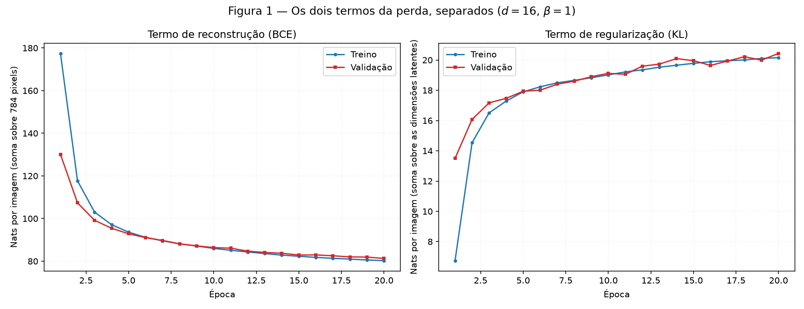
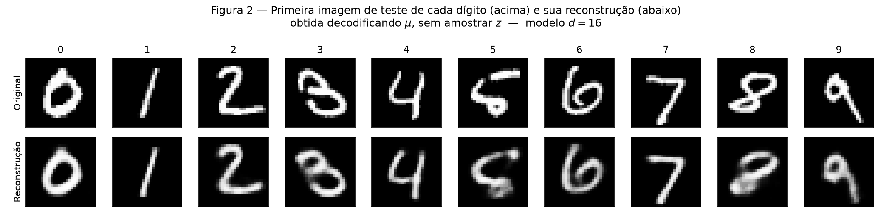
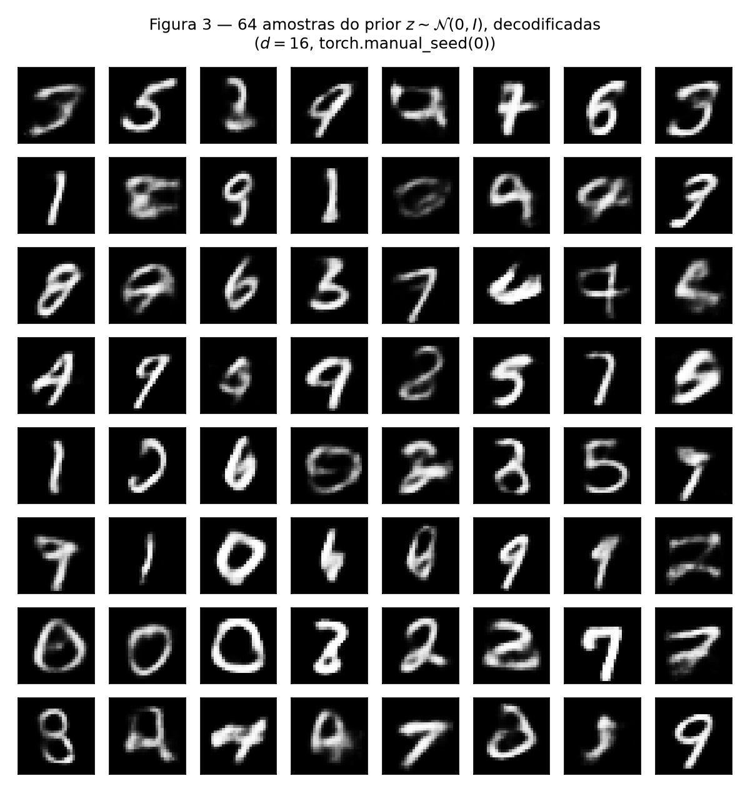
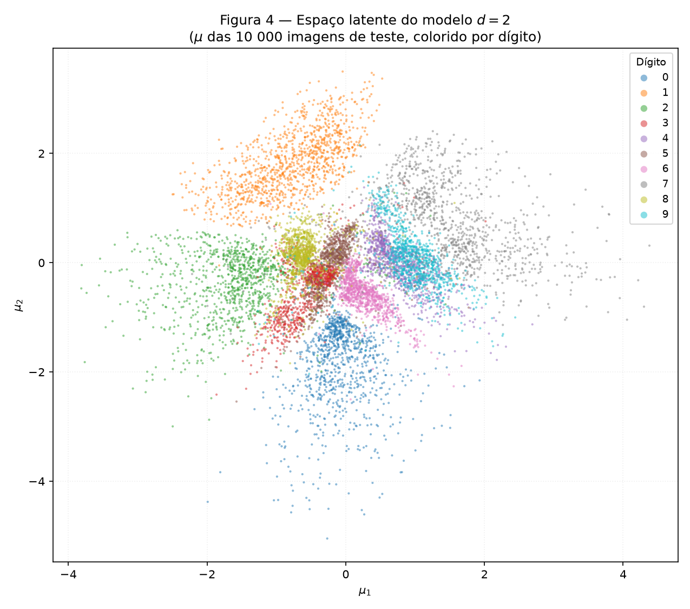
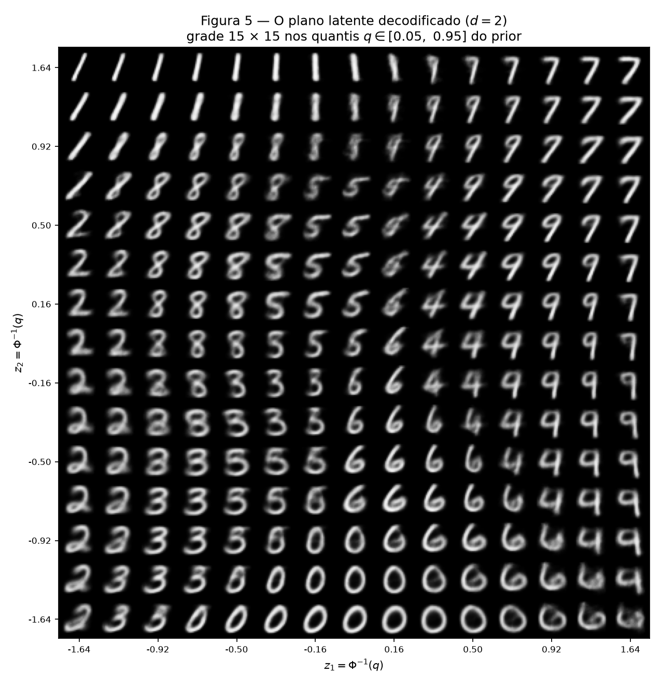
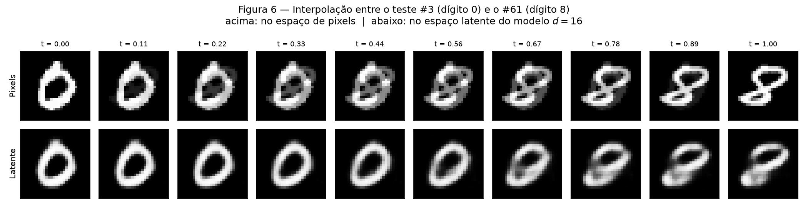

# 4. VAE

!!! abstract "Enunciado"

    [Exercises → VAE](https://insper.github.io/ann-dl/){:target='_blank'}

!!! info "Como reproduzir"

    O VAE precisa do PyTorch, que fica num `requirements` separado porque o
    GitHub Actions apenas constrói o site e não precisa baixá-lo:

    ```bash
    python -m pip install -r requirements.txt
    python -m pip install -r requirements-vae.txt
    python docs/exercises/vae/code/run_all.py
    ```

    O MNIST é baixado automaticamente pelo `torchvision` em `data/` (ignorado
    pelo Git). **Ambiente desta execução:** CPU, PyTorch 2.15.0+cpu — 204 s para
    treinar o modelo $d = 16$ e 217 s para o $d = 2$, 20 épocas cada.

**Estrutura do código.**

| Arquivo | Papel |
|---|---|
| `vae.py` | Modelo, reparametrização, os dois termos da perda e o laço de treino. |
| `run_all.py` | Ponto de entrada único: dados, os dois treinos, as seis figuras e as métricas. |

!!! warning "O que é escrito à mão"

    O autograd é permitido neste exercício, mas as partes específicas do VAE
    **não** vêm de biblioteca:

    - a **reparametrização** $z = \mu + \sigma \odot \varepsilon$, em `VAE.reparameterize`;
    - a **BCE somada sobre os 784 pixels**, em `reconstruction_bce`;
    - a **KL em forma fechada**, escrita termo a termo em `kl_divergence` — nada de `torch.distributions.kl_divergence`;
    - a **amostragem do prior**, em `VAE.sample`.

    Não há classe VAE de biblioteca: encoder e decoder são `nn.Sequential`
    montados no próprio arquivo.

    **Sementes:** `torch.manual_seed(42)` imediatamente antes de construir cada
    modelo, e o split com `torch.Generator().manual_seed(42)`. A grade de amostras
    do prior da Figura 3 usa `torch.manual_seed(0)`, como pedido.

    **O conjunto de teste é tocado uma única vez por modelo**, para os números
    finais. Todo o acompanhamento durante o treino é feito na validação.

??? note "`vae.py` — modelo, perda e treino"

    ``` { .python .copy .select linenums='1' title="docs/exercises/vae/code/vae.py" }
    --8<-- "docs/exercises/vae/code/vae.py"
    ```

??? note "`run_all.py` — dados, treinos e figuras"

    ``` { .python .copy .select linenums='1' title="docs/exercises/vae/code/run_all.py" }
    --8<-- "docs/exercises/vae/code/run_all.py"
    ```

## Exercise 1

### A — Load and split the data

MNIST do `torchvision` com `transforms.ToTensor()`, que já coloca os pixels em
$[0, 1]$, achatados em vetores de 784. As 60 000 imagens de treino são divididas
exatamente como o enunciado manda:

```python
train, val = random_split(train_full, [50_000, 10_000],
                          generator=torch.Generator().manual_seed(42))
```

| Conjunto | Imagens | Uso |
|---|---:|---|
| Treino | 50 000 | ajuste dos pesos |
| Validação | 10 000 | acompanhamento por época |
| Teste | 10 000 | **apenas** os números finais |

### B — Build the model

| Parte | Camadas |
|---|---|
| Encoder | $784 \to 512 \to 256$, ReLU após cada |
| Cabeças | duas lineares $256 \to d$: uma para $\boldsymbol{\mu}$, outra para $\log\boldsymbol{\sigma}^2$ |
| Decoder | $d \to 256 \to 512 \to 784$, ReLU nas escondidas, sigmoide na saída |

com $d = 16$. A perda por imagem, somada sobre pixels e sobre dimensões latentes:

$$
L = \underbrace{-\sum_{j=1}^{784}\Big[x_j \log \hat{x}_j + (1-x_j)\log(1-\hat{x}_j)\Big]}_{\text{reconstrução (BCE)}}
\;+\; \beta \cdot \underbrace{\tfrac{1}{2}\sum_{i=1}^{d}\left(\mu_i^2 + \sigma_i^2 - 1 - \log\sigma_i^2\right)}_{\text{KL}}
$$

com $\beta = 1$, **média sobre as imagens do lote**.

**Três decisões de implementação que valem explicação.**

*A rede prevê $\log\sigma^2$, não $\sigma$.* Prever o log deixa a saída livre em
toda a reta real — não há restrição de positividade a impor — e a exponencial
devolve sempre uma variância positiva. Daí $\sigma = \exp(\tfrac{1}{2}\log\sigma^2)$.

*A reparametrização existe porque amostrar não é diferenciável.* Sortear
$z \sim \mathcal{N}(\mu, \sigma^2)$ diretamente cortaria o grafo: não há gradiente
de uma amostra em relação aos parâmetros que a geraram. Escrevendo

$$
z = \mu + \sigma \odot \varepsilon, \qquad \varepsilon \sim \mathcal{N}(0, I)
$$

o ruído $\varepsilon$ passa a ser **independente** de $\mu$ e $\sigma$, e $z$ vira
uma função determinística deles. O gradiente volta a fluir para o encoder.

*A BCE é somada, não promediada, sobre os pixels.* Usa-se
`F.binary_cross_entropy(..., reduction="sum")` dividido pelo tamanho do lote. Com
`reduction="mean"` a média também cobriria os 784 pixels, encolhendo o termo de
reconstrução 784 vezes em relação à KL — o mesmo que definir
$\beta \approx 784$ sem perceber, e o modelo ignoraria a reconstrução.

### C — Train

Adam, $\text{lr} = 10^{-3}$, lote 128, 20 épocas. Os dois termos são registrados
separadamente, em treino e validação, ao fim de cada época.

**Números no conjunto de teste ($d = 16$), em nats por imagem:**

| Termo | Valor |
|---|---:|
| Reconstrução (BCE) | **80.7053** |
| KL | **20.5001** |
| **ELBO negativo** (soma) | **101.2054** |

Os valores de referência da página são ≈ 81 nats de reconstrução e ≈ 20 de KL —
esta execução caiu praticamente em cima deles.


/// caption
**Figura 1** — Reconstrução (esquerda) e KL (direita) por época, com treino e
validação em cada painel. As duas curvas andam quase coladas — nas dez últimas
épocas a validação fica, em média, apenas **0.910 nat acima** do treino na
reconstrução (≈ 1 % de 81 nats) e **0.102 nat** na KL. Com 50 000 imagens e 20
épocas não há sinal de sobreajuste.
///

O que a figura mostra, em números: a reconstrução de treino cai de **177.4523**
para **80.2635** nats, enquanto a KL **sobe** de **6.7438** para **20.1506**. Na
validação, a KL vai de **13.5007** na primeira época a **20.4353** na vigésima.

### D — Reconstructions and samples


/// caption
**Figura 2** — A primeira imagem de teste de cada dígito 0–9 (acima) e sua
reconstrução (abaixo), obtida **decodificando $\boldsymbol{\mu}$**, sem amostrar
$z$. Os dez dígitos continuam legíveis; o que se perde é nitidez de traço.
///


/// caption
**Figura 3** — Grade 8 × 8 decodificada de $z \sim \mathcal{N}(0, I)$, sorteada
após `torch.manual_seed(0)`. A maioria são dígitos reconhecíveis; alguns são
borrões que não são dígito nenhum.
///

### E — Analysis

#### Por que o otimizador escolhe pagar mais KL

Na Figura 1 a KL **sobe** durante todo o treino enquanto a perda total cai. Parece
contraditório, mas é o comportamento esperado — e a chave é enxergar a KL como
**preço**, não como erro.

No início, a rede está perto de $\mu \approx 0$ e $\log\sigma^2 \approx 0$, ou seja,
$q(z \mid x) \approx \mathcal{N}(0, I)$ para **toda** imagem. Esse é o estado de KL
mínima — de fato a KL da primeira época de treino é **6.7438**, a menor de toda a
corrida. Mas é também um estado inútil: se todas as imagens mapeiam para a mesma
distribuição latente, $z$ não carrega informação alguma sobre $x$, e o decoder só
pode devolver a média do dataset. Daí a reconstrução inicial de **177.4523** nats.

Para reconstruir, o encoder precisa fazer o oposto: dar a imagens diferentes
valores de $z$ diferentes — isto é, **espalhar os $\mu$** e **encolher os $\sigma$**.
E é exatamente isso que a KL cobra: os termos $\mu_i^2$ e $-\log\sigma_i^2$ crescem
quando o posterior se afasta do prior. A KL é, com boa aproximação, **a quantidade
de informação sobre $x$ que o modelo decidiu guardar em $z$**, medida em nats.

O otimizador faz, portanto, uma troca, e os números mostram que ela compensa com
folga:

| | Época 1 (treino) | Época 20 (treino) | Variação |
|---|---:|---:|---:|
| Reconstrução | 177.4523 | 80.2635 | **−97.1888 nats** |
| KL | 6.7438 | 20.1506 | **+13.4068 nats** |
| Total | 184.1961 | 100.4141 | **−83.7820 nats** |

Cada nat extra de KL comprou cerca de **7.25 nats** de reconstrução. A KL sobe
porque vale a pena subir — e ela estabiliza em torno de 20 quando o retorno
marginal se iguala ao custo.

#### Por que a Figura 3 parece pior que a Figura 2 — duas razões distintas

**Razão 1 — onde as amostras do prior caem.** A Figura 2 decodifica $\mu$ de
imagens reais: por construção, esses pontos estão **onde o encoder efetivamente
colocou dados**, e o decoder treinou ali. A Figura 3 sorteia $z \sim \mathcal{N}(0, I)$.
O problema é que o **posterior agregado** — a média de $q(z \mid x)$ sobre o dataset
— não coincide exatamente com o prior. Ele deixa **buracos**: regiões com massa
sob $\mathcal{N}(0, I)$ mas sem nenhuma imagem de treino por perto. A KL de 20.5
nats é justamente a medida de quanto o posterior se afastou do prior. Uma amostra
que cai num buraco é decodificada por uma parte da rede que nunca viu dado algum,
e sai um borrão que não é dígito — vários visíveis na Figura 3.

**Razão 2 — o que o decoder devolve para um $z$ dado.** O decoder emite a **média**
de uma Bernoulli por pixel, não uma imagem sorteada. Para um $z$ qualquer existem
muitas imagens plausíveis — o mesmo ponto latente é compatível com vários traçados
do mesmo dígito. Minimizar a BCE leva o decoder a emitir, em cada pixel, a
**média sobre todas essas imagens**; e a média de vários dígitos ligeiramente
diferentes é uma imagem **borrada**. É a mesma razão pela qual as reconstruções da
Figura 2 também são macias, mas o efeito é mais forte na Figura 3 porque ali o $z$
não está preso a uma imagem específica.

As duas razões são independentes: a primeira é sobre a **geometria do espaço
latente** (onde se amostra) e a segunda sobre a **função de perda** (o que se
devolve). Mesmo com um posterior agregado perfeitamente igual ao prior, a razão 2
continuaria produzindo borrões.

#### Por que decodificar $\boldsymbol{\mu}$ e não um $z$ amostrado na Figura 2

Porque a Figura 2 mede **quanta informação sobrevive ao gargalo**, e amostrar
acrescentaria uma fonte de ruído que não tem nada a ver com isso. $\boldsymbol{\mu}$
é a melhor estimativa pontual do encoder para onde aquela imagem vive no espaço
latente — a média (e a moda) de $q(z \mid x)$. Decodificá-lo responde: "da melhor
representação que o modelo construiu desta imagem, quanto ele consegue recuperar?"

Amostrar $z = \mu + \sigma\varepsilon$ tornaria a figura **não determinística**:
rodando duas vezes sairiam reconstruções diferentes, e parte da degradação visível
seria o sorteio, não o modelo. Para uma figura cujo propósito é comparar original e
reconstrução, isso é ruído que atrapalha a leitura.

## Exercise 2

### A — Train a 2-D VAE

Mesmo modelo, mesmos dados, mesma semente, mesmo $\beta$ e mesmo orçamento de
treino. **A única mudança é $d = 2$.**

| | $d = 16$ | $d = 2$ | Diferença |
|---|---:|---:|---:|
| Reconstrução (BCE) no teste | **80.7053** | **133.9618** | **+53.2566** |
| KL no teste | **20.5001** | **6.8655** | **−13.6346** |
| ELBO negativo | **101.2054** | **140.8274** | **+39.6220** |

(A página antecipa ≈ 135 e ≈ 7 nats para $d = 2$; a execução deu 133.96 e 6.87.)

Os dois termos se movem em sentidos opostos, e isso é coerente: com apenas duas
dimensões **não há onde guardar informação**, então o modelo paga muito menos KL —
6.87 contra 20.50 nats. O preço aparece na reconstrução, 66 % pior. O ELBO negativo,
que soma os dois, piora 39.6 nats.

### B — The encoded test set


/// caption
**Figura 4** — $\boldsymbol{\mu}$ das 10 000 imagens de teste, colorido por dígito.
O prior $\mathcal{N}(0, I)$ mantém a nuvem compacta em torno da origem; dentro dela
os dígitos se organizam em setores.
///

### C — The decoded plane


/// caption
**Figura 5** — Grade 15 × 15 de pontos latentes decodificados, dispostos no mesmo
arranjo. Os eixos são $z = \Phi^{-1}(q)$ com $q$ igualmente espaçado em
$[0.05,\ 0.95]$.
///

**Por que esse espaçamento dá a cada célula a mesma massa do prior.** Por definição
da função de distribuição acumulada, se $z \sim \mathcal{N}(0,1)$ então
$\Phi(z)$ é uniforme em $[0,1]$; logo, tomar $q$ igualmente espaçado e aplicar
$z = \Phi^{-1}(q)$ faz com que **passos iguais em $q$ correspondam a incrementos
iguais de probabilidade acumulada** — cada uma das 15 faixas por eixo cobre
$(0.95 - 0.05)/15 = 0.06$ da massa do prior.

Espaçar linearmente em $z$ faria o contrário: concentraria células nas caudas, onde
o prior quase não tem massa e o decoder viu pouquíssimo dado de treino, e
subamostraria o centro, onde está quase tudo.

### D — Interpolation


/// caption
**Figura 6** — Interpolação em 10 passos entre duas imagens de teste. **Acima:**
no espaço de pixels, $(1-t)\,\mathbf{x}_a + t\,\mathbf{x}_b$. **Abaixo:** no espaço
latente do modelo $d = 16$ do Exercise 1, decodificando
$(1-t)\,\boldsymbol{\mu}_a + t\,\boldsymbol{\mu}_b$.
///

As duas imagens escolhidas, com os **índices no conjunto de teste**:

| | Índice | Dígito |
|---|---:|---:|
| $\mathbf{x}_a$ | **3** | 0 |
| $\mathbf{x}_b$ | **61** | 8 |

São as primeiras ocorrências de um 0 e de um 8 no conjunto de teste — escolha fixa,
não sorteada.

### E — Analysis

#### Quais dígitos se sobrepõem, e como é a transição na Figura 5

A Figura 4 organiza os dígitos em setores em torno da origem. Alguns ficam
isolados — o **1** ocupa sozinho a faixa superior esquerda, o **0** a parte
inferior, o **2** toda a esquerda. Outros se interpenetram no miolo.

Para não depender de leitura a olho, a sobreposição foi **medida**: para cada uma
das 10 000 imagens de teste, o código olha seus 10 vizinhos mais próximos em
$\boldsymbol{\mu}$ e conta quantos pertencem a outro dígito. No total, **23.27 %**
das vizinhanças são de outro dígito, e as ligações cruzadas se concentram assim:

| Par de dígitos | Ligações cruzadas | % do total |
|---|---:|---:|
| **4 ↔ 9** | **5981** | **25.7 %** |
| 3 ↔ 8 | 2991 | 12.9 % |
| 3 ↔ 5 | 2640 | 11.3 % |
| 7 ↔ 9 | 1748 | 7.5 % |
| 5 ↔ 8 | 1384 | 5.9 % |
| 4 ↔ 7 | 862 | 3.7 % |

O par **4 ↔ 9 responde sozinho por mais de um quarto** de toda a mistura —
praticamente o dobro do segundo colocado (5981 contra 2991 ligações). Depois dele
vem o agrupamento **3 / 5 / 8**, cujos três pares somados (3↔8, 3↔5, 5↔8) dão
30.2 %. Juntos, esses dois focos explicam 55.9 % das ligações cruzadas. São exatamente os conjuntos que se confundem para leitores
humanos: um 4 de topo fechado é um 9, e 3, 5 e 8 compartilham a mesma barriga
inferior.

A Figura 5 mostra as mesmas vizinhanças como transições contínuas, e ler as duas
figuras juntas é o ponto do exercício. Percorrendo uma linha do meio da Figura 5 da
esquerda para a direita, a sequência é

$$
2 \;\to\; 8 \;\to\; 5 \;\to\; 6 \;\to\; 4 \;\to\; 9 \;\to\; 7
$$

e cada seta corresponde a uma fronteira entre setores vizinhos da Figura 4. As
imagens intermediárias são **híbridos genuínos**, não misturas borradas: na
passagem $8 \to 5$ aparecem formas com o laço superior do 8 já aberto, mas a barriga
inferior ainda fechada; na passagem $4 \to 9$ — o par de maior sobreposição medida
—, traços em que o topo do 4 vai se fechando até virar o laço do 9, e há colunas em
que é impossível dizer qual dos dois está escrito. No canto superior a transição
$1 \to 7$ se dá por inclinação progressiva, com o traço horizontal do 7 emergindo
aos poucos.

Isso não é acidente do modelo nem defeito do treino: um 4 e um 9 **são** parecidos
em pixels, e o encoder é premiado por reconstruir, não por separar classes — ele
nunca viu os rótulos. Colocar 4 e 9 longe um do outro no plano custaria
reconstrução em outras direções, sem ganho algum na perda. A sobreposição é a
resposta correta ao objetivo que o modelo recebeu.

#### O que duas dimensões obrigam o modelo a jogar fora

A conta direta: $d = 16$ guarda 16 números por imagem; $d = 2$ guarda 2. A
reconstrução piora de **80.7053** para **133.9618** nats — **+53.26 nats, 66 % pior**.

A Figura 5 mostra **o que** foi descartado. Repare que, ao longo da grade, varia a
**identidade** do dígito e, no máximo, uma inclinação ou largura grosseira. O que
*não* varia é o estilo: todos os 2 da grade são essencialmente o mesmo 2
prototípico, todos os 0 o mesmo 0. Com duas coordenadas o modelo consegue construir
um **mapa de qual dígito é**, e sobra quase nada para registrar *como aquele dígito
específico foi escrito* — espessura do traço, inclinação individual, tamanho do
laço, se o 7 tem corte, se o 1 tem a base. Essas são justamente as variações que
distinguem uma amostra de outra do mesmo dígito, e é por isso que o erro de
reconstrução sobe tanto.

Em $d = 16$ sobram dimensões para esse estilo, e por isso as reconstruções da
Figura 2 preservam traços individuais — compare o 5 e o 9 originais com suas
reconstruções: a inclinação particular de cada um sobrevive.

#### As duas linhas da Figura 6

**A linha de cima não passa por dígitos; a de baixo passa.**

Na **interpolação em pixels**, os quadros intermediários ($t$ entre 0.33 e 0.67) são
uma **dupla exposição**: o 0 e o 8 aparecem simultaneamente, ambos a meia
intensidade, sobrepostos como duas fotografias no mesmo negativo. Nenhum desses
quadros é um dígito. A razão é que a média de duas imagens é uma operação sobre
pixels independentes, e **o conjunto das imagens que parecem dígitos não é convexo**:
o segmento de reta entre dois dígitos no espaço de 784 dimensões sai imediatamente
desse conjunto. Não existe caneta que desenhe "metade de um 0 somado a metade de
um 8"; existe apenas a sobreposição.

Na **interpolação latente**, todos os dez quadros parecem dígitos. O 0 vai se
estreitando e inclinando, a parte superior começa a se fechar, e por volta de
$t = 0.67$ já se lê um 8. Duas coisas explicam isso. Primeiro, o VAE aprendeu um
espaço latente em que os dados ocupam uma **região conexa e aproximadamente
convexa** — o termo de KL empurra ativamente o posterior agregado para uma
gaussiana, que é convexa, de modo que o segmento entre dois pontos com dados
permanece em território povoado. Segundo, o decoder **só sabe produzir** coisas
parecidas com o que viu no treino: qualquer que seja o $z$ de entrada, a saída é
uma combinação do repertório de dígitos. Ele não tem como desenhar uma dupla
exposição.

É essa diferença que torna o espaço latente útil: operações geométricas simples
nele — médias, segmentos de reta — correspondem a operações **semânticas** no
espaço das imagens.

## Results summary

| # | Quantity | Value |
|---:|---|---|
| 1 | Ex. 1 — test reconstruction, KL and negative ELBO (\(d = 16\)) | BCE = **80.7053**, KL = **20.5001**, −ELBO = **101.2054** nats/imagem |
| 2 | Ex. 1 — validation KL at the first and at the last epoch | época 1 = **13.5007**, época 20 = **20.4353** nats/imagem |
| 3 | Ex. 2 — test reconstruction and KL (\(d = 2\)) | BCE = **133.9618**, KL = **6.8655** nats/imagem (−ELBO = 140.8274) |
| 4 | Ex. 2 — the two test indices interpolated | teste **#3** (dígito 0) e teste **#61** (dígito 8) |
