# 1. EDA — NYC Airbnb: é possível estimar o preço de uma diária?

!!! abstract "Entrega 1 de 3 do [Projeto](../index.md)"

    [Projects](https://insper.github.io/ann-dl/){:target='_blank'} ·
    Tarefa: **regressão** · Alvo: **`price`** (US$/noite)

!!! info "Equipe"

    | Nome completo | GitHub |
    |---------------|--------|
    | Giovanny José Vieira Russo | [giovannyjvr](https://github.com/giovannyjvr) |

    **Equipe incompleta.** Só há um integrante confirmado; os demais não foram
    preenchidos e **não foram inventados**. Ver a [página do projeto](../index.md).

!!! danger "Status da proposta: não confirmado"

    Não há no repositório nenhum registro de aprovação desta proposta de dataset
    pelo professor. A análise técnica foi feita mesmo assim, mas **a aprovação
    precisa ser confirmada antes da submissão**.

!!! info "Como reproduzir"

    Todos os números deste relatório saem de uma única execução. A partir da raiz
    do repositório:

    ```bash
    python -m pip install -r requirements.txt -r requirements-eda.txt
    python docs/projects/eda/code/run_eda.py
    ```

    O CSV **não** é versionado: o KaggleHub o baixa em qualquer clone limpo, sem
    credencial (o dataset é público). `run_eda.py` leva ~2,5 min, grava as 15
    figuras em `figures/` e todos os números em `results/metrics.json`.

**Estrutura do código.**

| Arquivo | Papel |
|---|---|
| `nyc_preprocessing.py` | Módulo **importável**: carrega, valida, separa treino/teste e monta a `Pipeline`. É o que a entrega de regressão vai reaproveitar. |
| `run_eda.py` | Ponto de entrada único: roda as etapas 0–5, produz as figuras e as métricas. |
| `Cópia_de_Hands_on_EDA_Redução_de_dimensionalidade (1).ipynb` | Notebook auxiliar da disciplina (Palmer Penguins), usado como referência metodológica. |

??? note "`nyc_preprocessing.py` — a pipeline importável"

    ``` { .python .copy .select linenums='1' title="docs/projects/eda/code/nyc_preprocessing.py" }
    --8<-- "docs/projects/eda/code/nyc_preprocessing.py"
    ```

??? note "`run_eda.py` — a análise de ponta a ponta"

    ``` { .python .copy .select linenums='1' title="docs/projects/eda/code/run_eda.py" }
    --8<-- "docs/projects/eda/code/run_eda.py"
    ```

!!! note "O que veio do notebook auxiliar, e o que não veio"

    O notebook da disciplina analisa **Palmer Penguins**. Dele reaproveitamos o
    *método*, não os resultados: a separação entre o que o EDA pode ver e o que
    só o treino pode ensinar; a verificação após cada operação; o truque de usar
    a média do teste **diferente de zero** como prova de que a escala não vazou;
    a leitura dos *loadings* antes de olhar o gráfico; a comparação de PCA,
    t-SNE e UMAP sob o mesmo critério; e o controle com dados embaralhados.

    Nenhum valor, gráfico ou conclusão dos pinguins foi transportado. O notebook
    usa `random_state=0`; **aqui tudo usa 42**, como a rubrica exige.

---

## Etapa 0 — Proposta e adequação do dataset

| Requisito | Situação | Evidência |
|---|---|---|
| Público e tabular | ✅ | Kaggle, licença **CC0: Public Domain** (campo `licenseName` da API) |
| ≥ 1 000 instâncias | ✅ | **48 895** linhas |
| ≥ 5 features numéricas e categóricas | ✅ | **7 numéricas** + **3 categóricas** + 1 data (sem contar alvo e identificadores) |
| Alvo no próprio arquivo | ✅ | `price`, coluna 10 de `AB_NYC_2019.csv` |
| Não é dataset clássico da disciplina | ✅ | O material da disciplina usa Palmer Penguins, Titanic e Spaceship Titanic |

- **URL:** <https://www.kaggle.com/datasets/dgomonov/new-york-city-airbnb-open-data>
- **Arquivo:** `AB_NYC_2019.csv` — **48 895 × 16**, validado por `load_dataset()`,
  que recusa o arquivo se nome, colunas, dimensão ou tipo do alvo não baterem.
- **Alvo:** `price` — diária anunciada em dólares, contínua.
- **Motivação para regressão:** o alvo já é contínuo e vem no arquivo.
  Transformá-lo em classes jogaria fora exatamente a informação que torna o
  problema interessante — a diferença entre um quarto de US$ 45 e um apartamento
  de US$ 300 não é categórica.

!!! warning "Primeiro risco identificado"

    **A assimetria do alvo: 19,12.** `price` vai de 10 a 10 000 dólares, com
    mediana 106 e média 152,72. Uma rede treinada com erro quadrático sobre essa
    escala vai perseguir as poucas centenas de anúncios de luxo e ignorar a massa:
    os **2,14 %** que passam de US$ 500 respondem por **86,1 %** da soma dos
    desvios quadráticos. A seção 1C quantifica, e a 5 propõe o tratamento.

---

## Etapa 1 — Inspeção inicial

### 1A — Dicionário de dados

Cada linha é **um anúncio do Airbnb ativo na cidade de Nova York em 2019**, com
localização, tipo de acomodação, regras de estadia e histórico agregado de
avaliações. Não é uma reserva nem uma estadia: é a oferta.

O **tipo físico** é o que o pandas leu; o **tipo analítico** é como a coluna deve
ser tratada na modelagem. Os dois divergem em cinco colunas — `id` e `host_id` são
inteiros que não devem ser usados como números, e `last_review` é texto que é data.

| Coluna | Tipo físico | Tipo analítico | Significado | Unidade |
|---|---|---|---|---|
| `id` | int64 | **identificador** | Código do anúncio na plataforma | — |
| `name` | str | **texto livre** | Título do anúncio escrito pelo anfitrião | — |
| `host_id` | int64 | **identificador** | Código do anfitrião | — |
| `host_name` | str | **identificador** | Primeiro nome do anfitrião | — |
| `neighbourhood_group` | str | categórica nominal | Distrito (*borough*) de NYC | 5 níveis |
| `neighbourhood` | str | categórica nominal | Bairro | 221 níveis |
| `latitude` | float64 | numérica contínua | Latitude do anúncio | graus decimais |
| `longitude` | float64 | numérica contínua | Longitude do anúncio | graus decimais |
| `room_type` | str | categórica nominal | Tipo de acomodação ofertada | 3 níveis |
| **`price`** | int64 | **alvo, numérica contínua** | **Diária anunciada** | **US$/noite** |
| `minimum_nights` | int64 | numérica discreta | Mínimo de noites exigido pela reserva | noites |
| `number_of_reviews` | int64 | numérica discreta | Total de avaliações acumuladas | contagem |
| `last_review` | str | **data** | Data da avaliação mais recente | AAAA-MM-DD |
| `reviews_per_month` | float64 | numérica contínua | Média de avaliações por mês | avaliações/mês |
| `calculated_host_listings_count` | int64 | numérica discreta | Quantos anúncios o mesmo anfitrião mantém | contagem |
| `availability_365` | int64 | numérica discreta | Dias disponíveis no calendário do ano | dias (0–365) |

!!! note "Duas colunas que a documentação não explica, e que não vamos adivinhar"

    `calculated_host_listings_count` é descrito pela fonte apenas como "número de
    anúncios do anfitrião". **Não está documentado** se a contagem é do momento da
    coleta ou histórica, nem se cobre a cidade inteira. Tratamos como contagem na
    data do *snapshot*, que é a leitura conservadora.

    `availability_365` tem **17 533 zeros** (35,86 %). Zero pode significar
    "calendário lotado" ou "anfitrião não abriu o calendário" — a fonte não
    distingue, e as duas coisas têm implicações opostas para o preço. Mantivemos a
    coluna e registramos a ambiguidade; é um item para a prova de projeto.

### 1B — Qualidade

#### Valores ausentes

| Coluna | Ausentes | % do total |
|---|---:|---:|
| `last_review` | 10 052 | **20,56 %** |
| `reviews_per_month` | 10 052 | **20,56 %** |
| `host_name` | 21 | 0,04 % |
| `name` | 16 | 0,03 % |
| *(as outras 12 colunas)* | 0 | 0,00 % |

**A ausência não é aleatória — é estrutural, e o código confirma isso em vez de
supor.** As 10 052 linhas sem `last_review` são **exatamente** as 10 052 com
`number_of_reviews == 0`:

```text
missing_iff_zero_reviews: True
```

Não existe "data da última avaliação" de um anúncio que nunca foi avaliado. Isso
muda a estratégia: imputar a **mediana** em `reviews_per_month` inventaria
atividade onde não houve nenhuma. O valor correto é **0**, e a informação "nunca
foi avaliado" vira uma coluna própria (seção 4A).

#### Linhas duplicadas

| Critério | Duplicatas |
|---|---:|
| Linha inteira idêntica | **0** |
| `id` repetido | **0** |
| Chave de negócio (`host_id` + `name` + `latitude` + `longitude` + `room_type`) | **0** |

Nenhuma deduplicação é necessária. O terceiro critério existe porque o mesmo
anúncio poderia ter sido coletado duas vezes com `id` diferente — não foi o caso.

#### Valores impossíveis ou inconsistentes

| Regra | Linhas | Decisão |
|---|---:|---|
| `price <= 0` | **11** | **Removidas** — ver abaixo |
| `price > 1000` | 239 | Mantidas: são anúncios de luxo reais, não erro |
| `minimum_nights > 365` | 14 | Mantidas, mas winsorizadas (seção 4A) |
| `reviews_per_month > 31` | 1 | Mantida, winsorizada — mais de uma avaliação por dia é implausível, mas é 1 linha |
| `availability_365 == 0` | 17 533 | Mantidas — ambíguo, não impossível (ver nota em 1A) |
| `latitude` fora de NYC | 0 | — |
| `longitude` fora de NYC | 0 | — |

**Sobre as 11 linhas com `price = 0`.** Uma diária de zero dólar não é uma
observação da grandeza que queremos prever: é anúncio inativo, erro de cadastro ou
preço combinado fora da plataforma. Mantê-las ensinaria a rede a prever um valor
que não existe no domínio. São **11 linhas em 48 895 — 0,0225 %**; a base cai para
**48 884**. É a *única* filtragem aplicada ao alvo: os 239 anúncios acima de
US$ 1 000 **ficam**, porque são caros, não inválidos.

#### Identificadores, constantes e vazamento

| Coluna | Valores distintos | Razão distintos/linhas |
|---|---:|---:|
| `id` | 48 895 | **1,0000** |
| `name` | 47 905 | 0,9798 |
| `host_id` | 37 457 | 0,7661 |
| `host_name` | 11 452 | 0,2342 |

Nenhuma coluna é constante. **Nenhuma coluna é vazamento**, e vale dizer por quê:
vazamento é informação que só existe *depois* do fato previsto. Aqui o fato
previsto é o preço anunciado, e todas as colunas são atributos do próprio anúncio,
simultâneas a ele. `number_of_reviews` e `last_review` são posteriores à publicação,
mas são posteriores ao *preço* também — são o estado do anúncio no momento da
coleta, exatamente o que um sistema real teria em mãos.

#### Colunas descartadas

| Coluna | Justificativa |
|---|---|
| `id` | Identificador único por linha. Como feature, só permite decorar. |
| `host_id` | 37 457 valores para 48 895 linhas. Um one-hot disso seria memorização do anfitrião, não aprendizado de preço — e 76 % dos anfitriões apareceriam uma única vez. |
| `name` | Texto livre, 47 905 valores distintos. Tem sinal (palavras como *luxury*, *cozy*, *studio*), mas extraí-lo exige NLP, que está fora do escopo tabular desta entrega. **Registrado como trabalho futuro.** |
| `host_name` | Primeiro nome de pessoa. Não tem relação causal com preço, e usá-lo arriscaria codificar origem étnica — problema ético antes de ser técnico. |

`last_review` **não** é descartada: vira `days_since_last_review` (seção 4A).

### 1C — O alvo de regressão

| Estatística | Valor |
|---|---:|
| Contagem | 48 895 |
| **Média** | **152,72** |
| **Mediana** | **106,00** |
| Desvio-padrão | 240,15 |
| Mínimo | 0,00 |
| Q1 / Q3 | 69,00 / 175,00 |
| Percentil 99 | 799,00 |
| Máximo | 10 000,00 |
| **Assimetria** | **19,12** |
| Curtose | 585,67 |
| Assimetria após `log1p` | **0,63** |
| Anúncios com `price = 0` | 11 |
| Anúncios acima de US$ 500 | 2,14 % |
| Anúncios acima de US$ 1 000 | 0,49 % |

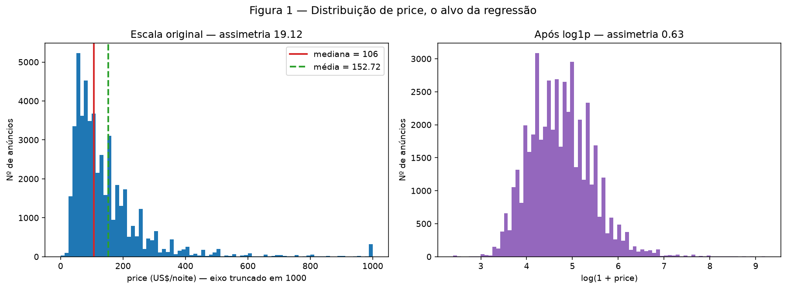
/// caption
**Figura 1** — `price` na escala original (eixo truncado em 1 000 para ser
legível) e após `log1p`.
///

**Conclusão da Figura 1.** A distribuição original é uma parede junto a zero com
uma cauda que se estende por duas ordens de grandeza: a média (152,72) fica
**44 % acima** da mediana (106), e o máximo é **94 vezes** a mediana. Depois do
`log1p`, a assimetria cai de **19,12 para 0,63** e o histograma fica
aproximadamente simétrico — quase gaussiano.

**O que isso significa para a modelagem.** Com erro quadrático, o que pesa no
gradiente não é a contagem de anúncios, é a soma dos desvios ao quadrado — e ela
está quase toda na cauda:

| Faixa | Anúncios | % da base | **% da soma dos desvios quadráticos** |
|---|---:|---:|---:|
| `price` > US$ 500 | 1 044 | 2,14 % | **86,1 %** |
| `price` > US$ 1 000 | 239 | 0,49 % | **76,3 %** |
| `price` ≤ mediana (106) | 24 472 | 50,05 % | **6,5 %** |

Metade da base responde por **6,5 %** do que o otimizador enxerga, enquanto 239
anúncios respondem por **76,3 %**. Um único anúncio de US$ 10 000 tem desvio
quadrático **44 424 vezes** maior que um na mediana. O modelo gastaria sua
capacidade em meio por cento dos dados.

A recomendação (seção 5) é **treinar sobre `log1p(price)` e reverter na
predição** — mas isso é decisão da entrega de regressão, e por isso a pipeline
desta entrega **não transforma o alvo**: ela entrega `y` cru e documenta o achado.

### 1D — Treino e teste

Separação feita **antes** de qualquer ajuste de pré-processamento, com
`train_test_split(..., test_size=0.2, random_state=42)`.

| | Linhas | `price` média | `price` mediana |
|---|---:|---:|---:|
| **Treino** | **39 107** | 153,18 | 106,00 |
| **Teste** | **9 777** | 151,06 | 107,00 |

**Por que 80/20.** Com 48 884 linhas, 20 % deixa **9 777** anúncios no teste — o
bastante para estimar o erro com precisão confortável, e sem tirar do treino uma
fatia que faça falta. Uma proporção maior de teste não compraria precisão
relevante e encolheria o treino sem motivo.

**Por que não estratificar.** Estratificação pede uma variável discreta, e o alvo
é contínuo. Em vez de inventar faixas, **verificamos o resultado**: média 153,18
contra 151,06 (diferença de 1,4 %) e mediana 106 contra 107. O sorteio saiu
equilibrado; se não tivesse saído, a alternativa seria estratificar por decil de
preço.

`price` fica fora de `X` por construção — `split_data()` o remove, e `run_eda.py`
confirma com `assert TARGET not in X_train.columns`. A partir daqui, **toda
estatística das etapas 2 e 3 é calculada só no treino**.

---

## Etapa 2 — Análise univariada *(somente treino)*

### 2A — Features numéricas

| Feature | Média | Mediana | Desvio | Q1 | Q3 | Máx | Assimetria | Ausentes |
|---|---:|---:|---:|---:|---:|---:|---:|---:|
| `minimum_nights` | 7,11 | 3,00 | 21,01 | 1,00 | 5,00 | 1 250 | **21,46** | 0 |
| `number_of_reviews` | 23,27 | 5,00 | 44,59 | 1,00 | 24,00 | 629 | 3,74 | 0 |
| `reviews_per_month` | 1,38 | 0,71 | 1,70 | 0,19 | 2,02 | 58,50 | 3,38 | **8 012** |
| `calculated_host_listings_count` | 7,12 | 1,00 | 32,81 | 1,00 | 2,00 | 327 | **7,96** | 0 |
| `latitude` | 40,729 | 40,723 | 0,055 | 40,690 | 40,763 | 40,913 | 0,24 | 0 |
| `longitude` | −73,952 | −73,956 | 0,046 | −73,983 | −73,936 | −73,713 | 1,30 | 0 |
| `availability_365` | 113,21 | 45,00 | 131,85 | 0,00 | 228,00 | 365 | 0,76 | 0 |

**Critério de seleção das figuras.** São sete features; a rubrica permite três
figuras. Em vez de um gráfico por coluna, agrupamos pelo problema que cada uma
apresenta: **duas figuras**, uma para as quatro de cauda pesada e outra para as
três de escala bem-comportada. A divisão não é estética — é a mesma que a pipeline
usa (`NUM_HEAVY` e `NUM_PLAIN`), e cada grupo recebe tratamento diferente na etapa 4.

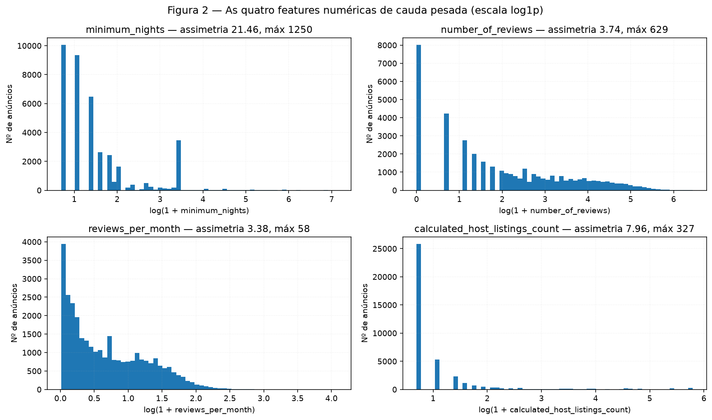
/// caption
**Figura 2** — As quatro features de cauda pesada, em escala `log1p` (na escala
original os histogramas são uma única barra).
///

**Conclusão da Figura 2.** As quatro compartilham a mesma patologia e cada uma por
um motivo diferente de negócio:

- `minimum_nights` tem assimetria **21,46** e máximo **1 250** — mais de três anos
  de estadia mínima. Em log aparecem **modas separadas** em 1, 2, 3, 7 e 30
  noites: anfitriões não escolhem números quaisquer, escolhem "uma noite", "uma
  semana", "um mês". É uma variável quase ordinal disfarçada de contínua.
- `calculated_host_listings_count` tem assimetria **7,96**: a mediana é **1** e o
  máximo **327**. Há dois regimes no mesmo eixo — o anfitrião que aluga o próprio
  quarto e a operação comercial com centenas de unidades.
- `number_of_reviews` e `reviews_per_month` decaem suavemente, sem modas
  múltiplas, mas com cauda longa.

Todas justificam `log1p` antes da escala — é o que a Figura 2 mostra ao ficar
legível só nessa escala.

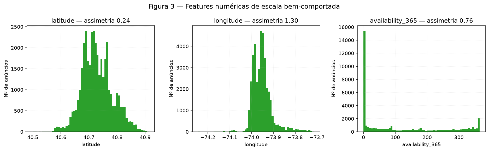
/// caption
**Figura 3** — `latitude`, `longitude` e `availability_365`.
///

**Conclusão da Figura 3.** Nenhuma precisa de `log1p`. `latitude` é quase simétrica
(0,24). `longitude` tem assimetria 1,30 e uma cauda à esquerda — são os anúncios de
Staten Island, geograficamente isolados do resto da cidade; é geografia real, não
distorção a corrigir. `availability_365` é o caso mais interessante: **bimodal**,
com um pico enorme em 0 (35,86 % da base) e outro em 365, e o meio esparso. Um
anúncio tende a estar "fechado" ou "aberto o ano todo"; o intermediário é minoria.

### 2B — Features categóricas

| Coluna | Cardinalidade (treino) | Ausentes | Categorias com < 50 linhas | Linhas nessas categorias |
|---|---:|---:|---:|---:|
| `neighbourhood_group` | **5** | 0 | 0 | 0 |
| `room_type` | **3** | 0 | 0 | 0 |
| `neighbourhood` | **218** | 0 | **130** | 1 867 (**4,77 %**) |

Frequências das duas de baixa cardinalidade, no treino:

| `neighbourhood_group` | n | % | | `room_type` | n | % |
|---|---:|---:|---|---|---:|---:|
| Manhattan | 17 344 | 44,35 | | Entire home/apt | 20 368 | 52,08 |
| Brooklyn | 16 059 | 41,06 | | Private room | 17 807 | 45,53 |
| Queens | 4 546 | 11,62 | | Shared room | 932 | 2,38 |
| Bronx | 866 | 2,21 | | | | |
| Staten Island | 292 | 0,75 | | | | |

Cinco bairros mais frequentes (de 218): Williamsburg (3 133 — 8,01 %),
Bedford-Stuyvesant (2 954 — 7,55 %), Harlem (2 137 — 5,46 %), Bushwick
(1 956 — 5,00 %) e Hell's Kitchen (1 574 — 4,02 %).

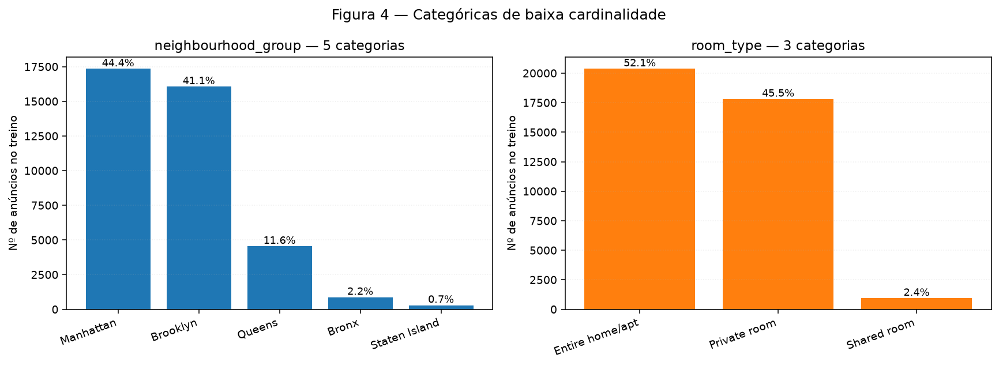
/// caption
**Figura 4** — Frequência das duas categóricas de baixa cardinalidade no treino.
///

**Conclusão da Figura 4.** Os dois desbalanceamentos são de naturezas diferentes.
Em `neighbourhood_group`, Manhattan e Brooklyn somam **85,4 %** e Staten Island
tem **0,75 %** — mas 292 linhas ainda são suficientes para estimar um efeito. Em
`room_type`, *Shared room* tem **932 linhas (2,38 %)**, e essa é a categoria com o
preço mais distinto (seção 3B): é pouca evidência justamente onde o efeito é maior.
Nenhuma das duas precisa de agrupamento — 3 e 5 níveis cabem em one-hot direto.

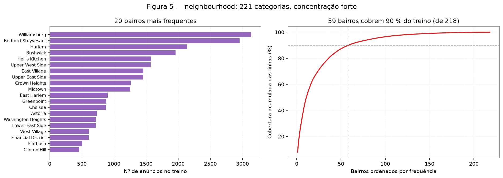
/// caption
**Figura 5** — `neighbourhood`: os 20 bairros mais frequentes e a cobertura
acumulada das 218 categorias presentes no treino.
///

**Conclusão da Figura 5.** A concentração é forte: **59 bairros cobrem 90 %** do
treino, e os 159 restantes dividem os 10 % finais — **130 deles têm menos de 50
anúncios**, somando 1 867 linhas (4,77 %).

**Efeito esperado sobre a codificação.** One-hot puro criaria 218 colunas, das
quais 130 teriam menos de 50 exemplos — ruído com nome de feature, e risco real de
uma categoria ficar inteiramente fora do treino. Foi o que aconteceu: **3 bairros
aparecem no teste e não no treino** (Bay Terrace/Staten Island, Rossville e
Woodrow). A decisão (seção 4A) é agrupar as raras num nível `infrequent`, que serve
de destino também para as inéditas. As frequências originais ficam preservadas na
tabela acima e em `results/metrics.json`.

---

## Etapa 3 — Análise bivariada e multivariada *(somente treino)*

### 3A — Numérica × numérica

**Por que Spearman e não Pearson.** As assimetrias vão de 0,24 a 21,46 (seção 2A) e
as relações com o preço não são lineares — dobrar o número de avaliações não dobra
nada. Pearson mediria o ajuste de uma reta que não existe, e seria dominado pelos
extremos que a Figura 2 mostrou. Spearman usa postos: é invariante a qualquer
transformação monótona, inclusive ao `log1p` que vamos aplicar depois.

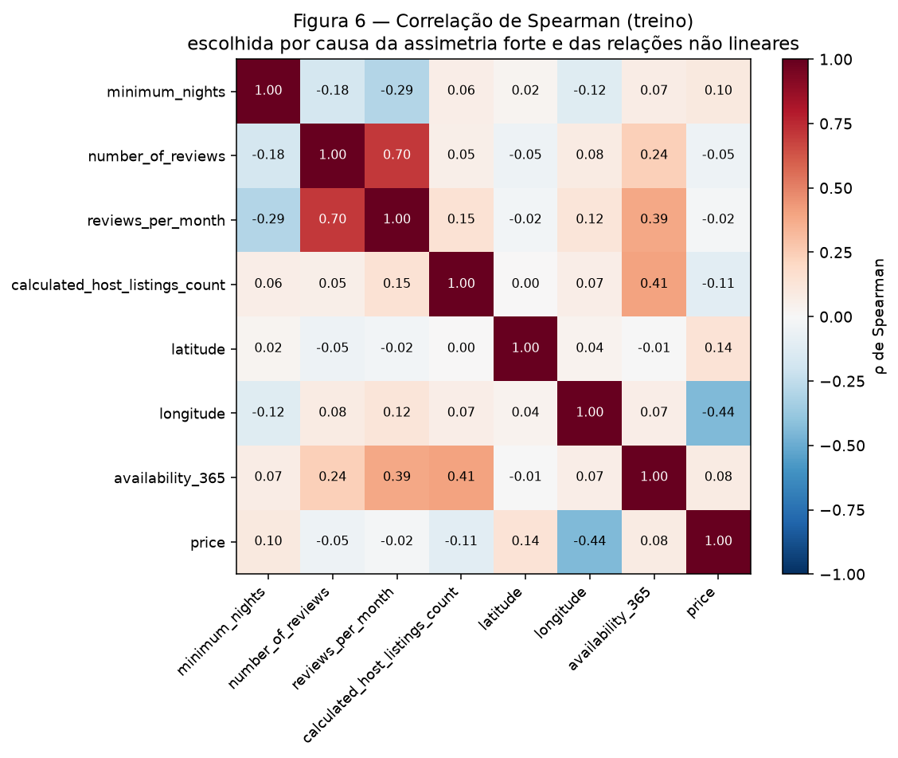
/// caption
**Figura 6** — Correlação de Spearman entre as features numéricas e `price`, no treino.
///

**Conclusão da Figura 6.** Correlação de Spearman com `price`:

| Feature | ρ com `price` |
|---|---:|
| `longitude` | **−0,4408** |
| `latitude` | +0,1367 |
| `calculated_host_listings_count` | −0,1080 |
| `minimum_nights` | +0,1004 |
| `availability_365` | +0,0844 |
| `number_of_reviews` | −0,0514 |
| `reviews_per_month` | −0,0190 |

Dois achados. Primeiro: **`longitude` é, sozinha, o preditor numérico mais forte**
(ρ = −0,4408), e com sinal negativo — quanto mais a leste, mais barato, porque ir
para leste é sair de Manhattan em direção a Queens. **Localização é o sinal
dominante**, e ela entra por duas portas (coordenadas e bairro). Segundo: **todas
as outras ficam abaixo de |0,14|**. Nenhuma feature isolada chega perto de explicar
o preço — é exatamente o cenário em que uma rede, que combina features, tem algo a
oferecer sobre uma regressão linear.

**Par de features mais correlacionado:** `number_of_reviews` × `reviews_per_month`,
**ρ = 0,7048**. É redundância esperada — uma é aproximadamente a outra dividida
pela idade do anúncio. Nenhum outro par passa de 0,5.

!!! question "Redundância justifica remover uma das duas?"

    **Não removemos.** 0,70 é alto, mas não é 0,95: as duas carregam informação
    distinta, porque a diferença entre elas *é* a idade do anúncio — um anúncio com
    200 avaliações e 0,5/mês é antigo e morno; com 200 e 5/mês é recente e quente.
    Para uma rede neural, colinearidade não é o problema que é para uma regressão
    linear (não há matriz a inverter). Mantemos as duas e registramos a redundância.

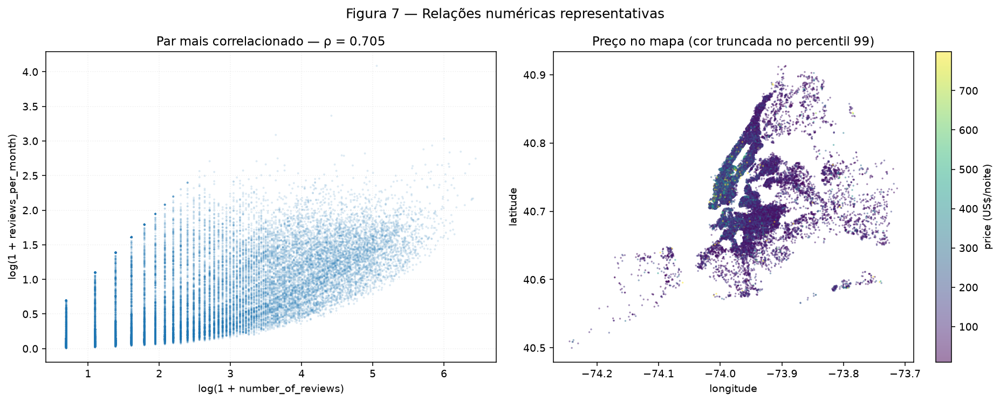
/// caption
**Figura 7** — Esquerda: o par mais correlacionado. Direita: os anúncios no mapa,
coloridos por `price` (cor truncada no percentil 99 para não ser dominada pela cauda).
///

**Conclusão da Figura 7.** À esquerda, a relação entre as duas colunas de avaliação
é monótona mas com dispersão larga — o que confirma a leitura acima: elas andam
juntas sem serem a mesma coisa. À direita está o achado central desta etapa: o
preço tem **estrutura espacial nítida**. A mancha clara (cara) se concentra no sul
de Manhattan e na faixa de Brooklyn colada à ponte; a periferia é uniformemente
escura. Isso explica por que `longitude` apareceu com ρ = −0,44 e antecipa que a
rede vai extrair muito de `latitude` × `longitude` **em conjunto** — uma interação
que nenhuma correlação de par consegue mostrar.

### 3B — Categórica × alvo

`price` por `room_type`, no treino:

| `room_type` | n | Mediana | Média | Q1 | Q3 | IQR |
|---|---:|---:|---:|---:|---:|---:|
| Entire home/apt | 20 368 | **160,00** | 212,61 | 120,00 | 228,00 | 108,00 |
| Private room | 17 807 | **70,00** | 89,62 | 50,00 | 95,00 | 45,00 |
| Shared room | 932 | **45,00** | 68,70 | 34,00 | 75,00 | 41,00 |

`price` por `neighbourhood_group`:

| `neighbourhood_group` | n | Mediana | Média | Q1 | Q3 | IQR |
|---|---:|---:|---:|---:|---:|---:|
| Manhattan | 17 344 | **150,00** | 198,51 | 95,00 | 220,00 | 125,00 |
| Brooklyn | 16 059 | **90,00** | 123,81 | 60,00 | 150,00 | 90,00 |
| Queens | 4 546 | **75,00** | 98,52 | 50,00 | 110,00 | 60,00 |
| Staten Island | 292 | **75,00** | 115,33 | 50,00 | 115,00 | 65,00 |
| Bronx | 866 | **65,00** | 89,63 | 45,25 | 100,00 | 54,75 |

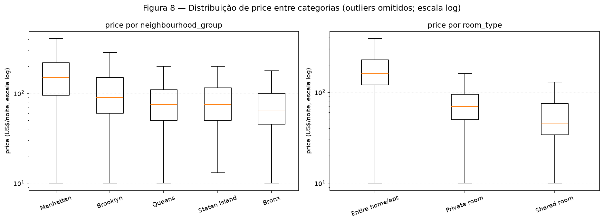
/// caption
**Figura 8** — Distribuição de `price` entre as categorias, em escala log, com
outliers omitidos para que as caixas fiquem legíveis.
///

**Conclusão da Figura 8.** `room_type` é o separador mais limpo do dataset: a
mediana de *Entire home/apt* é **3,6 vezes** a de *Shared room* (160 contra 45), e
as caixas de *Entire* e *Private* mal se tocam. `neighbourhood_group` separa menos,
mas de forma consistente — Manhattan (150) tem mediana **2,3 vezes** a do Bronx
(65). Note que as duas variáveis ordenam da mesma forma a dispersão: quanto mais
cara a categoria, maior o IQR. Isso é heterocedasticidade, e é um argumento
adicional para modelar em log.

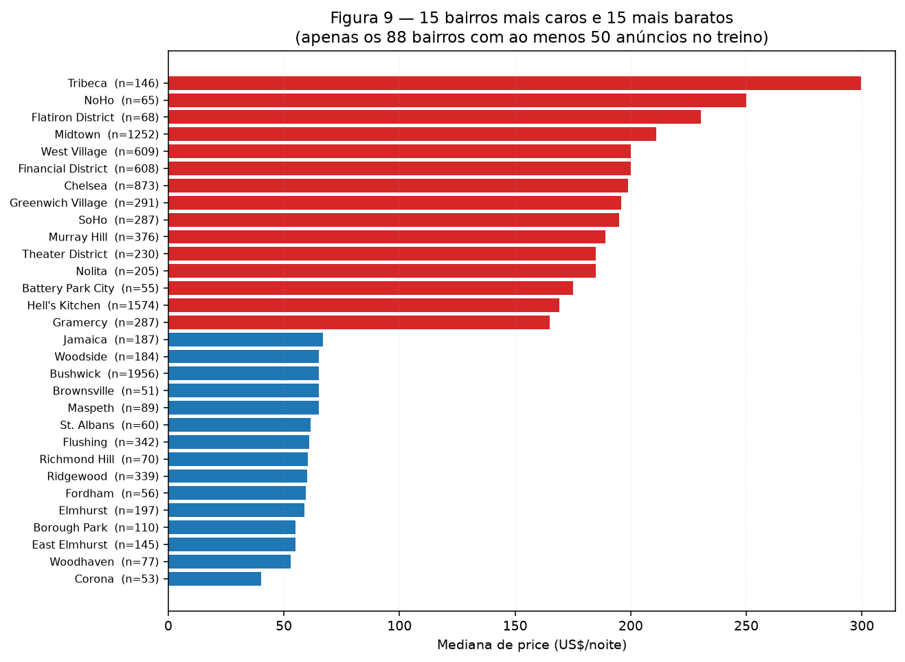
/// caption
**Figura 9** — Os 15 bairros mais caros e os 15 mais baratos, entre os 88 com ao
menos 50 anúncios no treino.
///

**Critério de seleção.** Mostrar 218 bairros seria ilegível e, pior, daria o mesmo
destaque visual a um bairro de 3 133 anúncios e a outro de 3. O corte em **n ≥ 50**
deixa **88 bairros** com mediana estável; a tabela completa está em
`results/metrics.json`.

**Conclusão da Figura 9.** A amplitude é enorme: **Tribeca com mediana 299,50**
(n = 146) contra **Corona com 40,00** (n = 53) — um fator de **7,5**, muito maior
que o fator 2,3 entre distritos. Ou seja: **o bairro carrega informação que o
distrito não carrega**, e as duas colunas não são redundantes. É o que justifica
pagar o custo de codificar 218 categorias em vez de ficar só com as 5 do distrito.

### 3C — Numérica × categórica

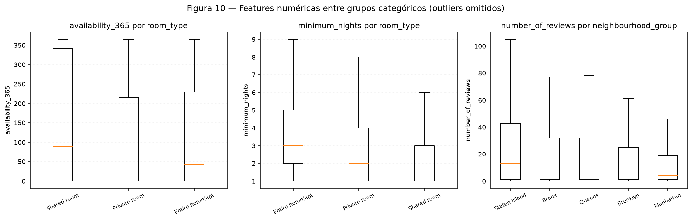
/// caption
**Figura 10** — Três relações numérica × categórica, com outliers omitidos.
///

| Relação | Grupo | Mediana | Média | n |
|---|---|---:|---:|---:|
| `availability_365` × `room_type` | Shared room | **90,0** | 162,96 | 932 |
| | Private room | 46,0 | 111,93 | 17 807 |
| | Entire home/apt | 42,0 | 112,06 | 20 368 |
| `minimum_nights` × `room_type` | Entire home/apt | **3,0** | 8,58 | 20 368 |
| | Private room | 2,0 | 5,52 | 17 807 |
| | Shared room | 1,0 | 5,39 | 932 |
| `number_of_reviews` × `neighbourhood_group` | Staten Island | **13,0** | 32,16 | 292 |
| | Bronx | 9,0 | 26,15 | 866 |
| | Queens | 7,5 | 28,16 | 4 546 |
| | Brooklyn | 6,0 | 24,16 | 16 059 |
| | Manhattan | 4,0 | 20,88 | 17 344 |

**Conclusão da Figura 10.** Os três painéis diferem em **localização**, e o
terceiro também em dispersão:

1. **`availability_365` × `room_type`** — *Shared room* tem mediana **90** dias
   contra 42–46 das outras duas, e média 163 contra ~112. Quartos compartilhados
   ficam mais tempo disponíveis, o que é consistente com serem mais difíceis de
   alugar. Ao mesmo tempo é a categoria mais barata: **disponibilidade alta é sinal
   de demanda baixa**, e isso dá a `availability_365` um papel preditivo que a
   correlação de 0,08 com o preço não revelou — o efeito existe *dentro* da
   categoria, não no agregado.
2. **`minimum_nights` × `room_type`** — apartamentos inteiros exigem mais noites
   (mediana 3) que quartos compartilhados (1). A regra de estadia acompanha o tipo
   de produto.
3. **`number_of_reviews` × `neighbourhood_group`** — a ordem é o **inverso** do
   preço: Manhattan tem a menor mediana de avaliações (4) e o maior preço;
   Staten Island tem a maior (13) e um dos menores preços. A leitura plausível é
   rotatividade — estadias curtas e frequentes na periferia barata, estadias mais
   longas e caras no centro. É uma hipótese, não uma conclusão: estes dados não
   contêm duração de estadia para testá-la.

---

## Etapa 4 — Pré-processamento

### 4A — Estratégias

Cada decisão aponta para o achado que a sustenta.

#### 1. Valores ausentes

| Coluna | Estratégia | Achado que justifica |
|---|---|---|
| `reviews_per_month` | **Constante 0** | 1B: a ausência é estrutural — são exatamente os anúncios com zero avaliações. Mediana inventaria atividade inexistente. |
| `last_review` → `days_since_last_review` | **Mediana do treino** + indicador `never_reviewed` | 1B: mesma ausência estrutural. A mediana é valor neutro; o indicador preserva a informação de que foi imputado. |
| `neighbourhood_group`, `room_type`, `neighbourhood` | Moda do treino | 2B: zero ausentes hoje; o imputador está ali como defesa para dados novos. |
| `latitude`, `longitude`, `availability_365` | Mediana do treino | 2A: zero ausentes; defesa preventiva. |

`last_review` é convertida em **dias desde a última avaliação**, contados a partir
da avaliação mais recente **vista no treino** (`reference_date_`). Aprender o
relógio no treino é o que impede o vazamento: o teste é medido contra a régua do
treino, não contra a própria.

#### 2. Outliers

**Winsorização nos percentis 1 e 99, aprendidos no treino**, aplicada às quatro
features de cauda pesada.

| Feature | Limite inferior | Limite superior |
|---|---:|---:|
| `minimum_nights` | 1,00 | **45,00** |
| `number_of_reviews` | 0,00 | **213,00** |
| `reviews_per_month` | 0,00 | **6,92** |
| `calculated_host_listings_count` | 1,00 | **232,00** |

| Conjunto | Linhas tocadas | % do conjunto |
|---|---:|---:|
| Treino | **1 370** | **3,50 %** |
| Teste | **320** | **3,27 %** |

**Por que winsorizar e não remover.** Remover linhas de treino por causa de uma
feature extrema descartaria o preço que as acompanha — e um anfitrião com 300
anúncios é informação legítima. Remover do teste seria pior: equivaleria a escolher
em quais exemplos o modelo é avaliado. Winsorizar mantém a linha e só puxa o valor
para o limite.

**Os limites vêm do treino e são aplicados ao teste sem recalcular.** É por isso
que as porcentagens diferem (3,50 % contra 3,27 %) — se fossem iguais, os limites
teriam sido reaprendidos no teste.

!!! warning "Outlier de feature ≠ extremo do alvo"

    A winsorização atinge **apenas features**. O alvo não é winsorizado: os 239
    anúncios acima de US$ 1 000 entram inteiros no treino e no teste. Achatar o
    alvo seria mudar o problema — e avaliar o modelo num alvo achatado daria uma
    métrica otimista que não se sustenta em produção. A única intervenção no alvo
    foram as **11 linhas com `price = 0`**, removidas em 1B.

#### 3. Codificação de categóricas

| Coluna | Codificação | Achado que justifica |
|---|---|---|
| `neighbourhood_group` (5), `room_type` (3) | `OneHotEncoder(handle_unknown="ignore")` | 2B: baixa cardinalidade, nenhuma categoria rara. |
| `neighbourhood` (218) | `OneHotEncoder(min_frequency=50, handle_unknown="infrequent_if_exist")` | 2B: 130 categorias com < 50 linhas; **3 bairros aparecem só no teste**. |

Para `neighbourhood`, `min_frequency=50` agrupa as raras num nível
`infrequent_sklearn` — e `handle_unknown="infrequent_if_exist"` manda um bairro
inédito para esse **mesmo** nível, em vez de uma linha de zeros. A diferença é
concreta: "um bairro pequeno que não conheço" é informação melhor que "nenhum
bairro". As 218 categorias viram **89 colunas** (88 frequentes + 1 `infrequent`).

Para as duas de baixa cardinalidade, `handle_unknown="ignore"` nunca dispara neste
split (0 categorias inéditas), mas fica como defesa.

#### 4. Escala

**`StandardScaler` sobre as oito numéricas, depois de `log1p` nas quatro de cauda
pesada.** As colunas one-hot e o indicador 0/1 **não** são escalados.

O destino é uma rede neural, e o que ela precisa é que nenhuma entrada domine o
gradiente por acidente de unidade. Antes da escala, `availability_365` varia em
[0, 365] e `latitude` em [40,5, 40,9] — a primeira teria peso ~900 vezes maior na
primeira camada. Depois do `log1p` + padronização, as oito ficam centradas em 0
com desvio 1, e as one-hot já vivem em {0, 1}.

!!! note "Por que `log1p` antes da padronização, e não só padronização"

    Padronizar sozinho não corrige assimetria: `minimum_nights` continuaria com
    assimetria 21,46, só que centrada. A maioria dos valores ficaria espremida
    perto de −0,3 enquanto uns poucos iriam a +59 desvios. O `log1p` comprime a
    cauda **antes**, e aí a padronização tem o que centrar. A Figura 2 é a
    evidência: aquelas distribuições só ficam legíveis em escala log.

### 4B — Redução de dimensionalidade

Tudo nesta seção roda sobre **as features de treino já pré-processadas**
(39 107 × 106). `price` **não entra** em nenhum dos três métodos — serve
exclusivamente para colorir.

**Amostra.** PCA roda no treino inteiro. t-SNE e UMAP rodam numa amostra de
**5 000 linhas** sorteadas sem reposição com `np.random.default_rng(42).choice` —
t-SNE é O(n²) em memória e 39 107 pontos não cabem. **A mesma amostra é usada nos
três métodos e em todas as configurações**, para que a comparação seja justa.

#### PCA

| | Valor |
|---|---:|
| Colunas de entrada | 106 |
| PC1 | **21,46 %** |
| PC2 | **16,86 %** |
| **PC1 + PC2** | **38,33 %** |
| Componentes para 80 % | **7** |
| Componentes para 95 % | **22** |

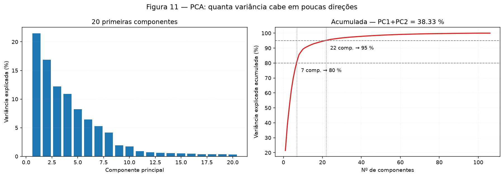
/// caption
**Figura 11** — Variância explicada por componente e acumulada.
///

**Conclusão da Figura 11.** PC1+PC2 retêm **38,33 %** — pouco, e o motivo não é
que os dados sejam ruidosos. É que a variância está repartida de forma muito
desigual entre os blocos de colunas:

| Bloco | Colunas | Variância | % do total |
|---|---:|---:|---:|
| Numéricas de cauda pesada (padronizadas) | 4 | 4,000 | **38,94 %** |
| Numéricas simples (padronizadas) | 4 | 4,000 | **38,94 %** |
| `neighbourhood_group` + `room_type` (one-hot) | 8 | 1,141 | 11,11 % |
| `neighbourhood` (one-hot) | **89** | 0,967 | **9,41 %** |
| Indicador `never_reviewed` | 1 | 0,163 | 1,59 % |

**As 8 colunas padronizadas carregam 77,9 % da variância; os 89 dummies de bairro,
9,4 %.** Uma coluna one-hot de um bairro com 2 % das linhas tem variância
0,02 × 0,98 ≈ 0,02, contra 1,0 de uma coluna padronizada. **A consequência é
direta: a PCA enxerga quase só o bloco numérico** — e é por isso que os *loadings*
abaixo não têm nenhuma feature geográfica no topo, apesar de a Figura 7 ter
mostrado que a geografia é o sinal mais forte.

*Loadings* dominantes:

| | PC1 | | PC2 |
|---|---:|---|---:|
| `reviews_per_month` | **+0,6152** | `calculated_host_listings_count` | **+0,6027** |
| `number_of_reviews` | **+0,5661** | `availability_365` | **+0,5474** |
| `days_since_last_review` | −0,3136 | `minimum_nights` | +0,4561 |
| `minimum_nights` | −0,2924 | `days_since_last_review` | −0,3034 |
| `availability_365` | +0,2020 | `latitude` | +0,1096 |

**PC1 é "atividade de avaliações"**: avaliações por mês e total crescem juntas, e a
recência entra com sinal contrário (menos dias desde a última avaliação = mais
ativo). **PC2 é "anfitrião profissional"**: muitos anúncios, calendário muito
aberto e estadia mínima longa — o perfil de operação comercial que a Figura 2
tinha sugerido ao mostrar dois regimes em `calculated_host_listings_count`.

Nenhum dos dois eixos é preço. **A PCA encontra os eixos de maior variância, e eles
não são os eixos que explicam o alvo** — um lembrete de que variância e relevância
são coisas diferentes.

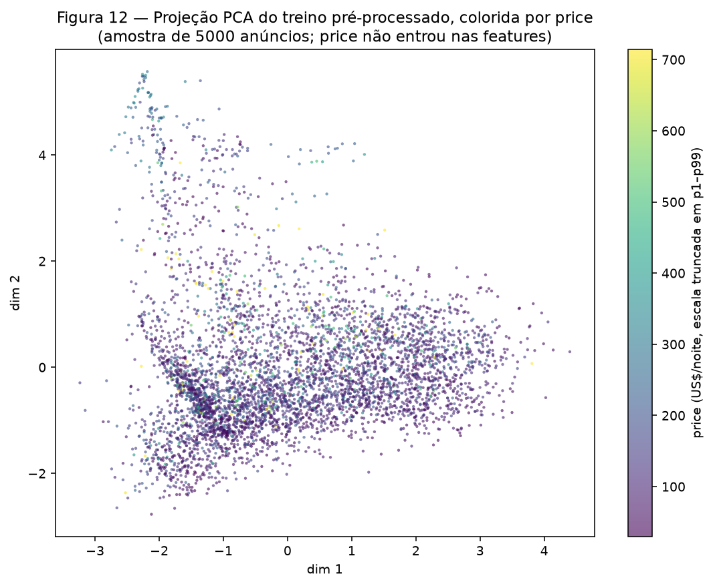
/// caption
**Figura 12** — Projeção PCA da amostra de treino, colorida por `price`.
///

**Conclusão da Figura 12.** A nuvem é um bloco contínuo, sem grupos, e a cor está
**espalhada sem padrão visível**. Anúncios caros e baratos ocupam a mesma região.
Isso é coerente com os *loadings*: se PC1 e PC2 descrevem atividade de avaliações e
perfil do anfitrião, e o preço é explicado principalmente por localização e tipo de
quarto, não há por que a cor se organizar nestes eixos.

#### t-SNE e UMAP

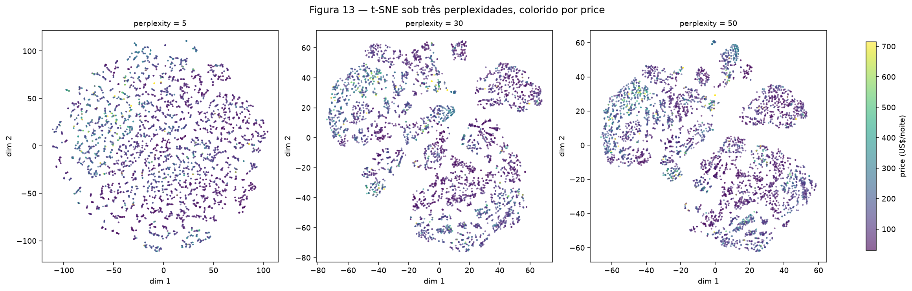
/// caption
**Figura 13** — t-SNE sob perplexidades 5, 30 e 50, colorido por `price`.
///

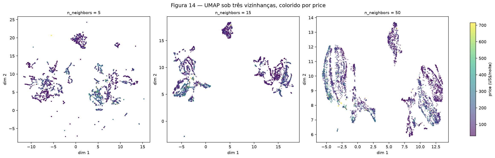
/// caption
**Figura 14** — UMAP sob `n_neighbors` 5, 15 e 50, colorido por `price`.
///

Os três métodos avaliados **pelo mesmo critério**, sobre a mesma amostra:

| Configuração | Trust k=5 (local) | Trust k=30 (global) | Dif. de log-preço entre vizinhos | Tempo* |
|---|---:|---:|---:|---:|
| **PCA** | 0,8170 | 0,8183 | 0,7078 | — |
| t-SNE perp = 5 | 0,9959 | 0,9568 | 0,5107 | 12,6 s |
| t-SNE perp = 30 | 0,9973 | 0,9831 | 0,5029 | 12,8 s |
| t-SNE perp = 50 | 0,9967 | 0,9852 | 0,5045 | 15,5 s |
| UMAP nn = 5 | 0,9896 | 0,9549 | 0,5166 | 40,5 s |
| UMAP nn = 15 | 0,9871 | 0,9756 | 0,5158 | 6,1 s |
| UMAP nn = 50 | 0,9828 | 0,9774 | 0,5268 | 9,8 s |
| *referência: pares aleatórios* | — | — | **0,7508** | — |

\* Tempo desta execução, nesta máquina. **É a única coluna que não reproduz**: as outras quatro saíram idênticas em três execuções independentes.

!!! note "A métrica da terceira coluna, e por que não é silhueta"

    Para classificação se usaria silhueta. O alvo aqui é **contínuo**, e silhueta
    exige rótulos. A pergunta equivalente é: *anúncios vizinhos no mapa têm preços
    parecidos?* A coluna mede a **diferença média de `log(1+price)` entre cada
    ponto e seus 15 vizinhos no mapa**. Quanto menor, mais o mapa agrupa preços
    semelhantes. A linha de base é a mesma diferença entre pares sorteados ao
    acaso: **0,7508**.

**Conclusão das Figuras 13 e 14 — o que os métodos não lineares mostram que a PCA
não revela.** Três leituras:

1. **Estrutura em grupos.** Onde a PCA mostrou um bloco único, t-SNE e UMAP
   revelam dezenas de aglomerados nítidos. Eles vêm das colunas categóricas:
   combinações de bairro × tipo de quarto que a PCA ignorou por terem pouca
   variância agora dominam a vizinhança, porque os métodos não lineares trabalham
   com **quem é vizinho de quem**, não com variância.
2. **O preço se organiza.** A diferença de log-preço entre vizinhos cai de
   **0,7508** (aleatório) para **0,5029** no melhor t-SNE — uma redução de 33 %. A
   PCA chega apenas a **0,7078**, ou seja, 6 % abaixo do acaso. **Os mapas não
   lineares agrupam preços parecidos; a PCA praticamente não.** É a diferença mais
   importante entre os três, e ela não é visível a olho nu — foi preciso medir.
3. **Local contra global.** A PCA tem *trustworthiness* ~0,82 em k = 5 e em k = 30,
   igual nas duas escalas: preserva a estrutura ampla e sacrifica a local. t-SNE e
   UMAP chegam a 0,99 em k = 5 e caem em k = 30. **Não há vencedor** — há dois
   objetivos, e qual importa depende da pergunta.

**Especificamente sobre a Figura 14.** O UMAP produz aglomerados mais compactos e
com mais espaço vazio entre eles que o t-SNE, e a tentação é ler isso como
"separou melhor". As métricas não sustentam: o UMAP fica **abaixo** do t-SNE tanto
em *trustworthiness* local (0,983–0,990 contra 0,996–0,997) quanto em homogeneidade
de preço (0,5158–0,5268 contra 0,5029–0,5107). A diferença visual é escolha de
layout do algoritmo, não mais estrutura encontrada. O que o UMAP tem de vantagem
real sobre o t-SNE é outra coisa — ele possui `.transform()`, como a tabela do fim
desta seção mostra.

!!! danger "O que estes mapas não autorizam a concluir"

    Distância entre grupos e tamanho de aglomerado em t-SNE e UMAP **não** são
    medidas de similaridade global. Dois grupos distantes na Figura 13 não são
    necessariamente mais diferentes que dois próximos — a escala é construída pela
    otimização, não herdada dos dados. Por isso as interpretações acima falam de
    **vizinhança** (que as métricas sustentam) e nunca de distância entre regiões.

**Sobre a escolha dos parâmetros.** A *trustworthiness* local é praticamente
idêntica nas três perplexidades (0,996–0,997) e nas três vizinhanças
(0,983–0,990), e a diferença de preço varia dentro de 0,024. **Nenhuma configuração
é claramente melhor** — o que é o resultado tranquilizador: a estrutura é estável
entre parâmetros, não um artefato de um ajuste particular. Escolher perplexidade 30
por "parecer mais separado" seria otimizar a aparência do gráfico; registramos as
três e não elegemos nenhuma.

#### O controle: o mesmo pipeline sobre ruído

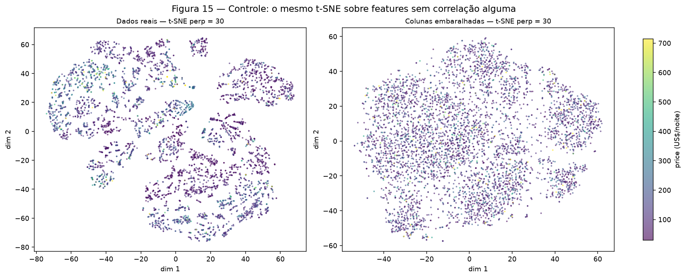
/// caption
**Figura 15** — t-SNE (perp = 30) sobre os dados reais e sobre as mesmas colunas
embaralhadas independentemente, o que destrói toda a correlação entre features e
preserva as distribuições marginais.
///

| | Trust k=5 | Dif. de log-preço entre vizinhos |
|---|---:|---:|
| Dados reais | 0,997 | **0,5029** |
| Colunas embaralhadas | **0,979** | **0,7491** |
| Pares aleatórios | — | 0,7508 |

**Conclusão da Figura 15, e é o resultado metodológico mais importante desta
etapa.** O controle **mantém *trustworthiness* de 0,979** — quase igual aos 0,997
dos dados reais. Se tivéssemos julgado o mapa só por essa métrica, teríamos
aprovado ruído puro. O que separa os dois é a outra coluna: nos dados embaralhados
a diferença de preço entre vizinhos é **0,7491**, indistinguível dos **0,7508** de
pares sorteados ao acaso.

Visualmente a diferença também é clara — os dados reais formam dezenas de
aglomerados com fronteiras, o embaralhado é uma mancha única. Mas a lição vale
mesmo assim: **uma métrica de qualidade de mapa não diz se o mapa significa
alguma coisa.** Só a comparação com o alvo diz, e só porque o alvo ficou de fora
das features.

#### Projetar dados novos

| Método | Tem `.transform()`? | Consequência |
|---|---|---|
| PCA | **Sim** | O teste foi projetado no mesmo espaço: `(9 777, 2)`. |
| UMAP | **Sim** | Reposiciona pontos novos no mapa já construído. |
| t-SNE | **Não** (`hasattr(TSNE(), "transform") == False`) | Otimiza posições, não aprende uma função. **Não pode entrar numa pipeline** nem servir dados novos. |

Por isso t-SNE fica fora de `nyc_preprocessing.py`: é ferramenta de exploração.

### 4C — Pipeline importável

O módulo é [`code/nyc_preprocessing.py`](https://github.com/giovannyjvr/exercicio-redes/blob/main/docs/projects/eda/code/nyc_preprocessing.py).

```python
from nyc_preprocessing import (
    load_dataset, drop_invalid_target, split_data, build_preprocessor, verify
)

df, _ = drop_invalid_target(load_dataset())
X_train, X_test, y_train, y_test = split_data(df)    # price fora de X

prep = build_preprocessor(X_train)
Z_train = prep.fit_transform(X_train)                # aprende E transforma
Z_test = prep.transform(X_test)                      # SÓ transforma

print(verify(prep, Z_train, Z_test))
```

Estrutura:

```text
Pipeline
├── ReviewRecencyAdder        last_review → days_since_last_review + never_reviewed
└── ColumnTransformer
    ├── heavy  (4 cols)  imputa 0 → winsoriza → log1p → padroniza
    ├── plain  (4 cols)  imputa mediana → padroniza
    ├── flag   (1 col)   passthrough (já é 0/1)
    ├── cat    (2 cols)  imputa moda → one-hot (handle_unknown="ignore")
    └── hicard (1 col)   imputa moda → one-hot (min_frequency=50,
                                      handle_unknown="infrequent_if_exist")
```

**Resultado e verificações automáticas.** `verify()` levanta `AssertionError` no
primeiro problema; todas passaram:

| Verificação | Resultado |
|---|---|
| Shape do treino | **(39 107, 106)** |
| Shape do teste | **(9 777, 106)** |
| Treino e teste com as mesmas colunas, na mesma ordem | ✅ |
| Nº de nomes de features = nº de colunas | ✅ 106 |
| `NaN` no treino / no teste | **0 / 0** |
| Valores infinitos | 0 |
| \|média\| máx. das colunas escaladas — **treino** | **6,99 × 10⁻¹⁴** |
| \|média\| máx. das colunas escaladas — **teste** | **0,0233** |

As 106 colunas: 4 (`heavy`) + 4 (`plain`) + 1 (`flag`) + 8 (`cat`) + 89 (`hicard`).

!!! success "A última linha da tabela é a prova de que não houve vazamento"

    A média do treino é zero (6,99 × 10⁻¹⁴ é ruído de ponto flutuante) porque o
    `StandardScaler` foi ajustado nele. **A média do teste é 0,0233 — e tinha que
    ser diferente de zero.** Se o teste também centrasse exatamente em zero, o
    escalonador teria visto o teste, e aí o número seria o sintoma de um erro, não
    a prova de acerto. É a mesma verificação que o notebook auxiliar ensina.

---

## Etapa 5 — Síntese para quem vai construir o regressor

### Principais achados

1. **O alvo é extremamente assimétrico** (19,12; Figura 1, seção 1C). Mediana 106,
   máximo 10 000. Após `log1p` a assimetria cai para 0,63.
2. **Localização é o sinal dominante, e entra por duas portas.** `longitude`
   sozinha dá ρ = −0,4408 com o preço — o triplo da segunda colocada (Figura 6) — e
   o mapa da Figura 7 mostra a concentração em Manhattan. O bairro acrescenta o que
   o distrito não tem: fator 7,5 entre Tribeca e Corona, contra 2,3 entre distritos
   (Figura 9).
3. **`room_type` é o separador categórico mais limpo**: medianas 160 / 70 / 45
   (Figura 8), fator 3,6 entre extremos.
4. **20,56 % dos anúncios nunca foram avaliados**, e essa ausência é estrutural —
   confirmada, não suposta (seção 1B).
5. **Nenhuma feature isolada explica o preço**: fora `longitude`, todas ficam
   abaixo de |0,14| (Figura 6). O ganho terá que vir de combinações — é onde uma
   rede supera um modelo linear.
6. **A estrutura dos dados é não linear.** PCA deixa a cor espalhada (Figura 12) e
   fica 6 % abaixo do acaso na homogeneidade de preço local; t-SNE chega a 33 %
   abaixo. Há estrutura, mas não nas direções de maior variância.

### Riscos de modelagem e plano de tratamento

| # | Risco | Evidência | Plano |
|---|---|---|---|
| 1 | Erro quadrático dominado pela cauda do alvo | 1C: assimetria 19,12; 0,49 % acima de US$ 1 000 | **Treinar sobre `log1p(price)`** e reverter com `expm1` na predição. Reportar MAE/RMSE na escala original, para a métrica continuar interpretável. |
| 2 | Heterocedasticidade | 3B: o IQR cresce com a mediana em todas as categorias | O mesmo `log1p` estabiliza a variância. |
| 3 | 89 colunas esparsas de bairro | 4B: carregam só 9,41 % da variância | Já mitigado por `min_frequency=50`. Se a rede sofrer, considerar *embedding* de bairro em vez de one-hot. |
| 4 | Bairro inédito em produção | 4A: 3 bairros só no teste | Já resolvido: `handle_unknown="infrequent_if_exist"`. |
| 5 | Vazamento por ajustar no conjunto todo | — | Já resolvido: tudo em `fit_transform(X_train)` + `transform(X_test)`, com a verificação da média do teste. |
| 6 | `availability_365 == 0` ambíguo | 1A, 2A: 35,86 % da base | Testar um indicador `zero_availability` separado e comparar; não resolver por adivinhação. |
| 7 | Baseline fraco demais | — | Comparar a rede contra: (a) prever sempre a mediana; (b) prever a mediana por `room_type` × `neighbourhood_group`. Sem isso não se sabe se a rede agregou algo. |

### Limitações do dataset e da análise

- **O dataset é de 2019 e é um *snapshot***. Não há série temporal, sazonalidade
  nem histórico de preço. Qualquer modelo aqui descreve NYC em 2019.
- **`price` é o preço *anunciado*, não o pago.** Não há taxa de limpeza, desconto
  nem ocupação. O modelo aprende o que o anfitrião pede, não o que o mercado paga.
- **Faltam atributos óbvios de valor**: número de quartos, de camas, de banheiros,
  comodidades, fotos, nota média de avaliação. A ausência deles é provavelmente o
  teto de qualquer modelo construído sobre esta base.
- **`name` foi descartada e carrega sinal.** Extraí-lo exige NLP; fica como
  trabalho futuro explícito, não como esquecimento.
- **t-SNE e UMAP rodaram em 5 000 das 39 107 linhas de treino**, por limitação
  computacional (t-SNE é O(n²)). A amostra é reproduzível e a mesma nos dois
  métodos, mas conclusões sobre estruturas raras podem não aparecer nela.
- **A relação entre avaliações e preço é hipótese, não achado** (seção 3C): não há
  duração de estadia nestes dados para testá-la.
- **A aprovação da proposta não está confirmada** (ver o aviso no topo).

---

## Results summary

| # | Resultado | Valor |
|---:|---|---|
| 1 | Dataset, tarefa e target | **NYC Airbnb Open Data** (`AB_NYC_2019.csv`, CC0) · **regressão** · alvo **`price`** em US$/noite |
| 2 | Instâncias × features numéricas / categóricas | **48 884 × (7 numéricas + 3 categóricas)**, mais 1 data (`last_review`) e 4 identificadores descartados; 48 895 antes de remover `price = 0` |
| 3 | Coluna com mais faltantes e percentual | **`last_review` e `reviews_per_month`, empatadas: 10 052 faltantes = 20,56 %** |
| 4 | Colunas descartadas e justificativas | **`id`** (identificador único), **`host_id`** (37 457 valores → memorização), **`name`** (texto livre, 47 905 valores, exige NLP), **`host_name`** (nome próprio, sem relação causal e com risco ético) |
| 5 | Média e mediana do target | **média 152,72 · mediana 106,00** (base completa); no treino, 153,18 e 106,00 |
| 6 | Tamanho dos conjuntos de treino e teste | **39 107 treino · 9 777 teste** (80/20, `random_state=42`) |
| 7 | Par numérico mais correlacionado e valor | **`number_of_reviews` × `reviews_per_month`, ρ de Spearman = 0,7048** |
| 8 | Linhas afetadas pela estratégia de outliers | **1 370 no treino (3,50 %) e 320 no teste (3,27 %)** winsorizadas; mais **11 linhas removidas** por `price = 0` |
| 9 | Variância explicada por PC1 + PC2 | **38,33 %** (PC1 21,46 % + PC2 16,86 %); 7 componentes para 80 %, 22 para 95 % |
| 10 | Shapes do treino e teste após a pipeline | **(39 107, 106) e (9 777, 106)**, com 0 `NaN` em ambos |
