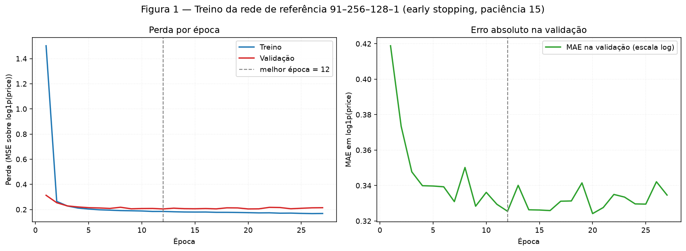
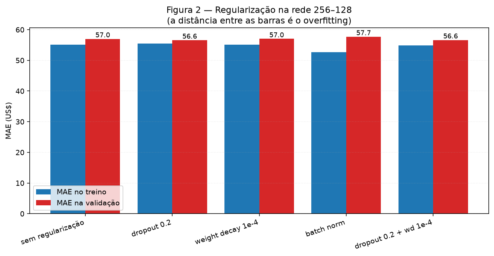
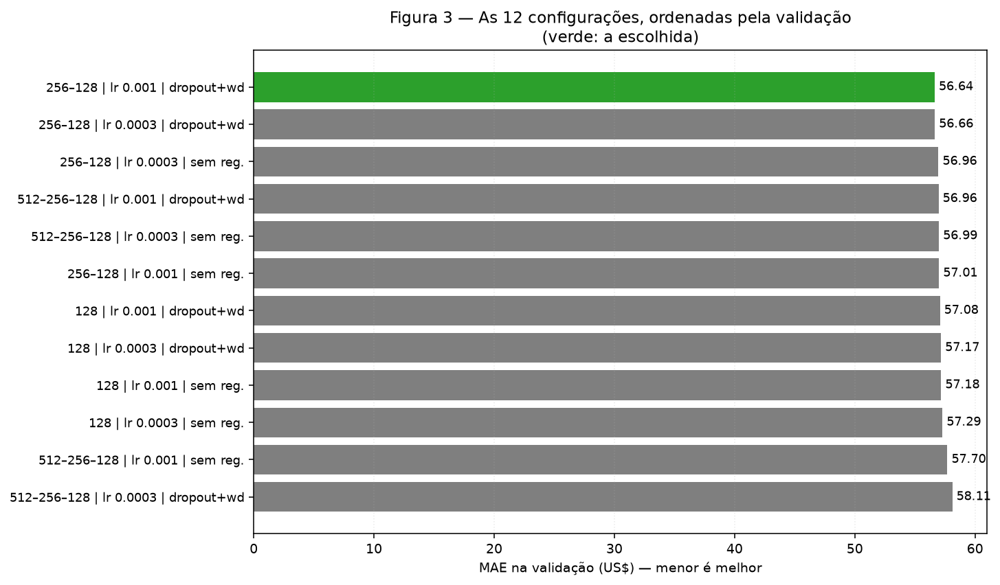
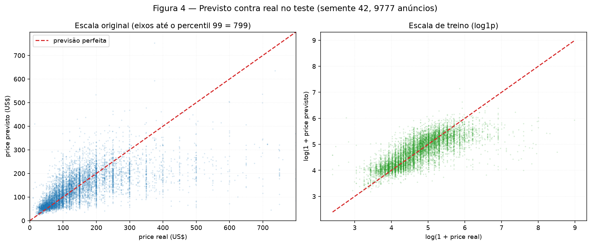
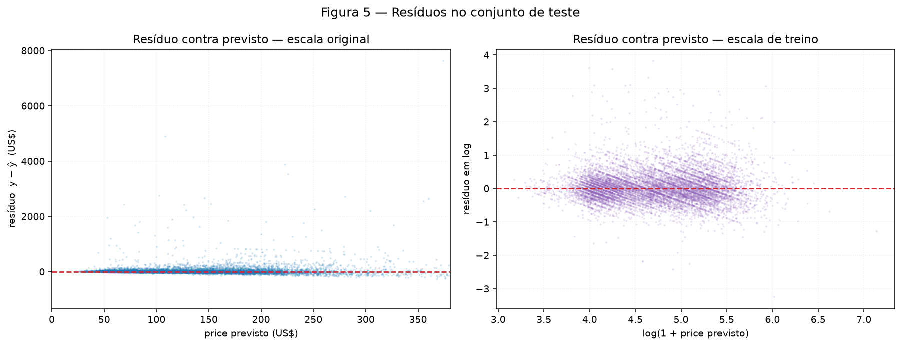
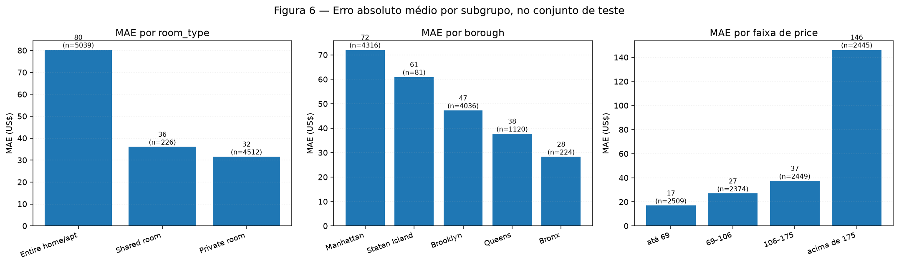
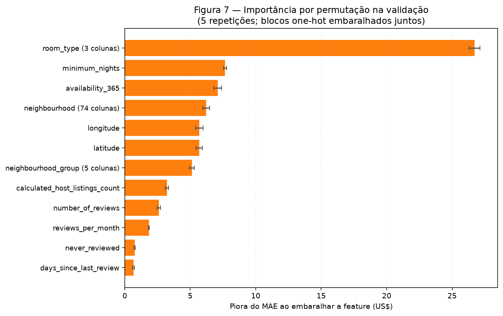

# 2. Regressão — uma rede aprende o preço de uma diária em NYC?

!!! abstract "Entrega 2 de 3 do [Projeto](../index.md)"

    [Projects → Classification or Regression](https://insper.github.io/ann-dl/2026.2/projects/supervised/){:target='_blank'}
    · Tarefa: **regressão** · Alvo: **`price`** (US$/noite)

!!! info "Equipe"

    | Nome completo | GitHub |
    |---------------|--------|
    | Giovanny José Vieira Russo | [giovannyjvr](https://github.com/giovannyjvr) |

    **Equipe incompleta** — só há um integrante confirmado; os demais não foram
    preenchidos e não foram inventados. Ver a [página do projeto](../index.md).

!!! danger "Duas pendências declaradas de saída"

    **Prazo.** A entrega venceu em **13/11/2026, 23:59**. Este relatório foi escrito
    em **18/11/2026** — cinco dias depois. O enunciado diz que o prazo não é
    estendido.

    **Correções do EDA.** A etapa 0 da rubrica pede a pipeline "com as correções
    que a avaliação do EDA apontou". **Não há devolutiva do EDA** no repositório,
    então não houve o que incorporar. As correções aplicadas foram as que a própria
    equipe encontrou ao reauditar o EDA, documentadas no registro de decisões.

!!! info "Como reproduzir"

    ```bash
    python -m pip install -r requirements.txt -r requirements-regression.txt
    python docs/projects/regression/code/run_regression.py
    ```

    O CSV não é versionado: o KaggleHub o baixa em qualquer clone limpo. O script
    executa as etapas 0–7, grava as 7 figuras em `figures/` e todos os números em
    `results/metrics.json`.

**Estrutura do código.**

| Arquivo | Papel |
|---|---|
| `nyc_regressor.py` | A MLP em PyTorch, o laço de treino com *early stopping*, as métricas e a importância por permutação. Importável. |
| `run_regression.py` | Ponto de entrada único das etapas 0–7. |
| `../eda/code/nyc_preprocessing.py` | **A pipeline do EDA, importada — não reescrita.** |

??? note "`nyc_regressor.py` — a rede e o laço de treino"

    ``` { .python .copy .select linenums='1' title="docs/projects/regression/code/nyc_regressor.py" }
    --8<-- "docs/projects/regression/code/nyc_regressor.py"
    ```

??? note "`run_regression.py` — as etapas 0 a 7"

    ``` { .python .copy .select linenums='1' title="docs/projects/regression/code/run_regression.py" }
    --8<-- "docs/projects/regression/code/run_regression.py"
    ```

---

## 0 · Ponto de partida

### A pipeline do EDA, importada

`run_regression.py` não reimplementa nada do pré-processamento: ele importa
`build_preprocessor`, `load_dataset`, `drop_invalid_target` e `verify` do módulo
da [entrega de EDA](../eda/index.md#4c-pipeline-importavel). O que muda aqui é
**onde ela é ajustada**.

| | EDA | Esta entrega |
|---|---|---|
| Split externo | 80/20, `random_state=42` | **o mesmo**, mesma semente |
| Validação | não havia | 20 % do treino, `random_state=42` |
| Pipeline ajustada em | 39 107 linhas (treino cheio) | **31 285** (só o sub-treino) |
| Colunas de saída | 106 | **91** |

**Por que 91 e não 106.** A pipeline é ajustada só no sub-treino, e
`OneHotEncoder(min_frequency=50)` passa a ver 31 285 linhas em vez de 39 107 —
menos bairros alcançam as 50 ocorrências, e os que não alcançam caem no nível
`infrequent`. Não é defeito: é a mesma regra aplicada ao conjunto que o modelo
pode ver. Ajustar a pipeline nos 39 107 deixaria a média e o desvio da escala
enxergarem a validação, que é justamente o conjunto usado para escolher
hiperparâmetros.

| Conjunto | Linhas | Papel |
|---|---:|---|
| Treino | **31 285** | ajusta a pipeline e os pesos |
| Validação | **7 822** | *early stopping*, perda, regularização, arquitetura |
| Teste | **9 777** | tocado **uma vez**, na etapa 5 |

Verificações da pipeline, devolvidas por `verify()`:

| Verificação | Resultado |
|---|---|
| `NaN` em treino / validação / teste | **0 / 0 / 0** |
| Treino e validação com as mesmas 91 colunas | ✅ |
| \|média\| máx. das colunas escaladas — **treino** | **2,01 × 10⁻¹³** |
| \|média\| máx. das colunas escaladas — **validação** | **0,0114** |

A última linha é a prova de que não houve vazamento: a média do treino é zero
porque o `StandardScaler` foi ajustado nele, e a da validação **tinha que ser
diferente de zero**. Se fosse zero também, o escalonador teria visto a validação.

### O alvo vai para `log1p`

O EDA mediu que **86,1 %** da soma dos desvios quadráticos de `price` vem dos
**2,14 %** de anúncios acima de US$ 500, e que a metade mais barata da base
responde por apenas **6,5 %**. Com erro quadrático na escala original, o gradiente
seria quase todo dos anúncios de luxo.

A rede treina sobre `log1p(price)` — que o EDA mostrou ter assimetria **0,63**
contra **19,12** da escala original — e **todas as métricas voltam para dólares**
com `expm1` antes de serem reportadas.

### Métrica principal e critério de sucesso

Fixados **antes de treinar**, no código (`SUCCESS_CRITERION` em
`run_regression.py`), não depois de ver o resultado:

| | |
|---|---|
| **Métrica principal** | MAE em dólares, no conjunto de teste |
| **Critério de sucesso** | MAE **ao menos 15 % menor** que o do melhor baseline |

MAE e não RMSE porque o alvo tem cauda muito pesada: o RMSE seria dominado pelos
mesmos poucos anúncios que motivaram o `log1p`, e um modelo pior para 99 % dos
anúncios poderia ganhar por acertar melhor dois de US$ 8 000.

---

## 1 · Baselines

Todos sobre **a mesma pipeline** e avaliados **na validação** — o teste não
participa desta etapa.

| Baseline | MAE | RMSE | R² |
|---|---:|---:|---:|
| **HistGradientBoosting (log1p)** | **55,92** | 183,82 | **0,2289** |
| Ridge (log1p) | 59,68 | 192,94 | 0,1505 |
| Mediana por `room_type` × borough | 64,03 | 200,54 | 0,0823 |
| `DummyRegressor` (mediana) | 83,24 | 214,66 | −0,0515 |
| `DummyRegressor` (média) | 91,44 | 209,34 | −0,0000 |

**Leitura.** Os dois triviais estão no lugar esperado: a média dá R² ≈ 0 por
construção, e a mediana erra menos em MAE (83,24 contra 91,44) porque o alvo é
assimétrico à direita — exatamente o que o EDA previu. O baseline de **mediana por
`room_type` × borough**, que o próprio EDA propôs, já derruba o MAE para 64,03
usando só duas colunas categóricas: é a evidência de que `room_type` e localização
carregam quase todo o sinal fácil.

O **Ridge** acrescenta pouco sobre isso (59,68), e o **boosting** é o mais forte
(**55,92**). A rubrica avisa que, em dado tabular, árvores costumam empatar com a
rede — e aqui elas partem na frente.

!!! warning "O critério ficou duro, de propósito"

    Com o melhor baseline em **55,92**, o critério de 15 % exige da rede um MAE de
    **47,53 ou menos** na validação. Manter o boosting na comparação, mesmo sendo
    opcional na rubrica, é o que torna o teste honesto: comparar só com a Ridge
    baixaria a régua sem que a rede tivesse melhorado.

---

## 2 · A rede

| | Escolha | Por quê |
|---|---|---|
| Entrada | 91 unidades | As 91 colunas que a pipeline do EDA produz |
| Camadas ocultas | **256 → 128** | Duas camadas, afunilando. A primeira precisa ser maior que a entrada para combinar as 82 colunas one-hot esparsas com as 8 numéricas densas; a segunda comprime |
| Ativação | **ReLU** | Não satura no lado positivo, e o alvo em log é aproximadamente simétrico — não há motivo para `tanh` |
| Inicialização | **He (Kaiming) normal** nas ocultas, **Xavier** na saída, vieses em 0 | He é a que corresponde à ReLU: compensa o fato de ela zerar metade das entradas, mantendo a variância da ativação estável ao longo da profundidade. A saída é linear, onde Xavier é a escolha apropriada |
| Saída | **1 unidade linear, sem ativação** | O alvo é contínuo em log e pode assumir qualquer real. Sigmoide ou ReLU na saída truncariam as previsões |
| Perda | **a etapa 4 decide** | MSE, Huber e MAE são comparados na validação, em vez de a escolha ser argumentada no texto |

**Parâmetros contra linhas de treino.**

| | Valor |
|---|---:|
| Arquitetura | **91–256–128–1** |
| Parâmetros treináveis | **56 577** |
| Linhas de treino | 31 285 |
| **Razão parâmetros / linhas** | **1,81** |

A rede tem **quase o dobro de parâmetros do que exemplos**. Isso não condena o
modelo — redes operam rotineiramente nesse regime —, mas diz que a regularização
não é opcional, e é por isso que ela ganha uma etapa inteira. A etapa 4 mede
quanto de fato sobra de *overfitting*.

---

## 3 · Treino

| | Escolha | Por quê |
|---|---|---|
| Otimizador | **AdamW** | Taxa adaptativa por parâmetro, que ajuda com entradas de escalas muito diferentes — 8 colunas padronizadas convivendo com 83 colunas one-hot quase sempre zero. O `W` separa o *weight decay* do gradiente adaptativo, o que torna o valor do decaimento comparável entre configurações |
| Learning rate | **1e-3** de partida | Valor padrão do Adam; a etapa 4 compara com 3e-4 |
| Batch size | **256** | 123 lotes por época em 31 285 linhas: ruído suficiente para escapar de mínimos rasos, e rápido em CPU |
| Épocas | até **200**, com parada antecipada | O teto nunca foi atingido — ver abaixo |
| *Early stopping* | **paciência 15** na perda de validação, **restaurando os melhores pesos** | Sem a restauração, o modelo entregue seria o da última época, que por definição é pior que o melhor visto |


/// caption
**Figura 1** — Perda de treino e de validação por época, e o MAE de validação na
escala de treino. A linha tracejada marca a melhor época.
///

**Conclusão da Figura 1.** A rede converge **muito rápido**: a perda cai de 1,50
para perto de 0,25 em **três épocas** e depois anda de lado. A melhor época é a
**12**, e o treino parou na **27** — a paciência de 15 épocas estourou sem nova
melhora, então o teto de 200 nunca chegou perto de ser usado.

Duas leituras:

1. **Onde começa o *overfitting*.** A partir da época 12 as duas curvas se
   separam: a de treino continua descendo devagar (até ~0,17) enquanto a de
   validação sobe de volta (~0,21). A distância é pequena, mas o sentido é
   inequívoco — depois da época 12 a rede está decorando, não aprendendo.
2. **O que a distância diz sobre a capacidade.** A separação é de apenas ~0,04 em
   perda, apesar dos 1,81 parâmetros por linha. Ou seja: **o modelo não está
   limitado por capacidade, e também não está estourando de overfitting** — ele
   bate num teto que não é de arquitetura. O painel da direita conta a mesma
   história: o MAE de validação em log desce de 0,419 para 0,325 e depois só
   oscila entre 0,32 e 0,34, sem tendência.

**A dificuldade real desta entrega não foi instabilidade de treino** — não houve
perda explodindo, nem saturação, nem necessidade de ajustar a taxa. Foi o
contrário: a rede converge em segundos e **empaca num patamar**. O resultado da
rede de referência, com MSE, foi **MAE 57,83 / RMSE 189,08 / R² 0,1842** na
validação — ou seja, **pior que o boosting (55,92)** já de saída. As etapas 4 e 5
tratam disso de frente.

---

## 4 · Regularização e hiperparâmetros

Tudo nesta etapa é decidido **na validação**. O teste não é tocado.

### 4.1 A função de perda

A rubrica pede a perda "justificada pelos *outliers* que o EDA encontrou". Em vez
de argumentar no texto, as três candidatas foram treinadas na mesma arquitetura
de referência:

| Perda | MAE val | RMSE val | R² val | Melhor época |
|---|---:|---:|---:|---:|
| MSE | 57,83 | **189,08** | **0,1842** | 12 |
| **Huber (δ = 0,5)** | **57,01** | 191,77 | 0,1608 | 16 |
| MAE (L1) | 57,37 | 190,86 | 0,1688 | 25 |

!!! note "Por que δ = 0,5 e não o 1,0 padrão"

    O Huber é quadrático para resíduos menores que δ e linear acima. Como a rede
    treina em `log1p(price)`, o resíduo típico fica perto de **0,33** (o MAE em
    log da Figura 1). Com δ = 1,0 quase tudo cairia na região quadrática e o
    Huber seria um MSE disfarçado. Com **δ = 0,5**, a parte linear passa a valer
    para erros acima de um fator $e^{0,5} \approx 1{,}65\times$ — que é onde os
    anúncios de luxo vivem.

**Conclusão.** O Huber vence no MAE (57,01 contra 57,83) e **perde** no RMSE e no
R². Não é contradição: é a definição das duas perdas se cumprindo. O MSE persegue
os resíduos grandes, então minimiza melhor o próprio RMSE; o Huber desiste dos
extremos e acerta melhor o grosso da distribuição, que é o que o MAE mede.

Como a métrica principal declarada na etapa 0 é o **MAE**, o Huber é a escolha
coerente — e foi usado da busca em diante. Vale registrar o incômodo: se a métrica
tivesse sido o RMSE, a decisão aqui seria outra, e é por isso que a rubrica manda
fixar a métrica **antes**.

### 4.2 Regularização

Três técnicas, cada uma contra a rede sem nenhuma, na arquitetura 256–128:

| Configuração | MAE val | MAE treino | Distância | Melhor época |
|---|---:|---:|---:|---:|
| Sem regularização | 57,01 | 55,16 | 1,84 | 16 |
| **Dropout 0,2** | **56,58** | 55,42 | **1,16** | 68 |
| Weight decay 1e-4 | 57,01 | 55,14 | 1,87 | 16 |
| BatchNorm | 57,70 | **52,63** | **5,07** | 24 |
| Dropout 0,2 + wd 1e-4 | 56,64 | 54,88 | 1,76 | 80 |


/// caption
**Figura 2** — MAE de treino e de validação para cada técnica. A distância entre
as barras de cada par é o *overfitting*.
///

**Conclusão da Figura 2.** Três resultados, e nenhum é o esperado de um modelo
sofrendo de excesso de capacidade:

1. **O *overfitting* é pequeno para começar.** Sem nenhuma regularização, a
   distância treino–validação é de **1,84 dólar** — menos de 4 % do MAE. Apesar
   dos 1,81 parâmetros por linha de treino, a rede não está decorando.
2. **O dropout ajuda pouco, e o weight decay não ajuda nada.** O dropout 0,2 tira
   **0,43** do MAE e corta a distância para 1,16, ao custo de **quatro vezes mais
   épocas** (68 contra 16). O weight decay de 1e-4 deixa o MAE **idêntico**
   (57,01) — é cedo demais para esse valor importar.
3. **BatchNorm foi a única que piorou, e de forma instrutiva.** O MAE de treino
   despencou para **52,63**, o melhor de todos, mas o de validação subiu para
   **57,70** — a distância quase **triplicou**, de 1,84 para **5,07**. A BatchNorm
   acelerou a otimização e, com isso, acelerou a memorização. É o lembrete de que
   normalizar não é regularizar.

### 4.3 Busca de 12 configurações

Três larguras × duas taxas de aprendizado × com e sem regularização, todas com a
perda Huber escolhida em 4.1, ordenadas pelo MAE de validação:

| # | Configuração | Parâmetros | MAE val | R² val | Melhor época |
|---:|---|---:|---:|---:|---:|
| **1** | **256–128 · lr 1e-3 · dropout+wd** | 56 577 | **56,64** | 0,1812 | 80 |
| 2 | 256–128 · lr 3e-4 · dropout+wd | 56 577 | 56,66 | 0,1633 | 111 |
| 3 | 256–128 · lr 3e-4 · sem reg. | 56 577 | 56,96 | 0,1737 | 39 |
| 4 | 512–256–128 · lr 1e-3 · dropout+wd | 211 457 | 56,96 | 0,1434 | 24 |
| 5 | 512–256–128 · lr 3e-4 · sem reg. | 211 457 | 56,99 | 0,1764 | 20 |
| 6 | 256–128 · lr 1e-3 · sem reg. | 56 577 | 57,01 | 0,1608 | 16 |
| 7 | 128 · lr 1e-3 · dropout+wd | 11 905 | 57,08 | 0,1628 | 86 |
| 8 | 128 · lr 3e-4 · dropout+wd | 11 905 | 57,17 | 0,1613 | 114 |
| 9 | 128 · lr 1e-3 · sem reg. | 11 905 | 57,18 | 0,1729 | 47 |
| 10 | 128 · lr 3e-4 · sem reg. | 11 905 | 57,29 | 0,1645 | 76 |
| 11 | 512–256–128 · lr 1e-3 · sem reg. | 211 457 | 57,70 | 0,1598 | 6 |
| 12 | 512–256–128 · lr 3e-4 · dropout+wd | 211 457 | 58,11 | 0,1356 | 69 |


/// caption
**Figura 3** — As 12 configurações ordenadas pelo MAE de validação. Em verde, a
escolhida.
///

**Conclusão da Figura 3.** O gráfico é quase uma linha reta, e esse é o achado.
**Entre a melhor (56,64) e a pior (58,11) há 1,47 dólar** — 2,6 % — enquanto o
número de parâmetros varia de **11 905 a 211 457**, um fator de **18**.

Multiplicar a capacidade por 18 move o MAE em menos de um dólar e meio. A
arquitetura média (256–128) ocupa as três primeiras posições; a maior aparece em
4º e também em **11º e 12º**, as duas piores — ela é a mais instável, não a mais
capaz. A configuração escolhida é a **256–128 · lr 1e-3 · dropout + weight decay**,
com **56 577 parâmetros**.

!!! warning "A busca é sequencial, não conjunta"

    A perda foi escolhida primeiro (4.1), e só depois a arquitetura e a
    regularização (4.3). É uma busca gulosa: pode existir um par
    (perda, arquitetura) melhor que nenhuma das duas etapas visitou. Uma busca
    conjunta custaria 3 × 12 = 36 treinos. Dada a planura observada — 1,47 dólar
    entre 12 configurações —, é improvável que a conjunta encontrasse outra coisa,
    mas isso é expectativa, não medição.

---

## 5 · Avaliação no teste

**O conjunto de teste é tocado aqui pela primeira e única vez.** Tudo acima foi
decidido na validação: a perda, a regularização, a arquitetura, a taxa e a época
de parada.

A configuração escolhida foi retreinada com **três sementes** (42, 43, 44), para
separar o desempenho do modelo da sorte da inicialização:

| Semente | MAE | RMSE | R² | MAPE | Épocas (melhor) |
|---|---:|---:|---:|---:|---:|
| 42 | 56,78 | 183,03 | 0,1632 | 32,39 % | 92 (80) |
| 43 | 56,58 | 183,38 | 0,1600 | 31,55 % | 72 (60) |
| 44 | 56,73 | 184,19 | 0,1526 | 31,77 % | 68 (56) |
| **Média ± desvio** | **56,70 ± 0,11** | **183,53 ± 0,59** | **0,1586 ± 0,0054** | **31,90 ± 0,44 %** | — |

### A rede contra todos os baselines, no mesmo teste

| Modelo | MAE | RMSE | R² | MAPE |
|---|---:|---:|---:|---:|
| **HistGradientBoosting (log1p)** | **56,31** | **179,19** | **0,1980** | 32,52 % |
| **Rede (3 sementes)** | 56,70 ± 0,11 | 183,53 | 0,1586 | **31,90 %** |
| Ridge (log1p) | 59,42 | 185,90 | 0,1368 | 34,80 % |
| Mediana por `room_type` × borough | 63,53 | 192,20 | 0,0773 | 37,09 % |
| `DummyRegressor` (mediana) | 82,73 | 205,32 | −0,0530 | 57,26 % |
| `DummyRegressor` (média) | 91,35 | 200,10 | −0,0001 | 90,71 % |

### O critério de sucesso **não foi cumprido**

| | Valor |
|---|---|
| Critério fixado na etapa 0 | MAE ao menos 15 % abaixo do melhor baseline |
| Melhor baseline (escolhido na validação) | HistGradientBoosting — MAE **56,31** no teste |
| Alvo para cumprir | MAE ≤ **47,86** |
| Rede | **56,70** |
| **Resultado** | **−0,68 % — a rede é 0,38 dólar PIOR** |

**E a diferença não é ruído.** O desvio entre sementes é **0,11**; a distância para
o boosting é **0,38**, ou seja **3,6 vezes** essa variação. Se a rede estivesse
empatada, a diferença ficaria dentro de um desvio — não fica. A rede perde, de
pouco, mas de forma reprodutível.

Contra o melhor baseline que a rubrica **exige** (a Ridge, já que o boosting entrou
como opcional), a rede melhora **4,58 %** — ainda muito longe dos 15 %.

!!! success "Onde a rede ganha"

    Uma coisa a rede faz melhor que todos: o **MAPE**, 31,90 % contra 32,52 % do
    boosting. É consistente com a escolha do Huber — ela acerta melhor o grosso
    dos anúncios e desiste dos extremos, e o MAPE pesa o erro relativo, onde os
    anúncios baratos contam tanto quanto os caros. O boosting ganha onde os
    extremos pesam: RMSE (179,19 contra 183,53) e R² (0,1980 contra 0,1586).


/// caption
**Figura 4** — Previsto contra real no teste, na escala original (eixos até o
percentil 99) e na escala de treino.
///

**Conclusão da Figura 4.** A nuvem fica **abaixo da diagonal** na parte alta e
**acima** na parte baixa: a clássica regressão à média. No painel da direita, em
log, a nuvem é mais simétrica em torno da diagonal, o que confirma que a
transformação fez o trabalho esperado — mas a inclinação da nuvem é **menor que a
da reta**, e essa diferença de inclinação *é* o encolhimento das previsões.


/// caption
**Figura 5** — Resíduo ($y - \hat{y}$) contra previsto, nas duas escalas.
///

**Conclusão da Figura 5.** Os dois painéis contam a mesma coisa em linguagens
diferentes:

- **Na escala original**, o resíduo abre em **leque para cima**: quanto maior a
  previsão, maior a dispersão, e quase todos os resíduos extremos são
  **positivos** — o modelo subestima. Isso é heterocedasticidade pura, e é
  exatamente o que o EDA antecipou ao mostrar que o IQR de `price` cresce com a
  mediana em toda categoria.
- **Na escala de treino**, o resíduo fica **centrado em zero** e aproximadamente
  simétrico, numa faixa de ±1. Ou seja: **o `log1p` resolveu a heterocedasticidade
  no espaço onde a rede otimiza**. O leque da esquerda não é falha do modelo — é o
  que acontece quando se desfaz a transformação.

Resta uma estrutura visível: no painel da direita a nuvem desce de leve da esquerda
para a direita. O modelo ainda deixa sinal na mesa, e a etapa 6 diz onde.

---

## 6 · Análise de erro

### Por subgrupo


/// caption
**Figura 6** — MAE por `room_type`, por borough e por faixa de `price`, no teste.
///

| `room_type` | n | MAE | Mediana de `price` |
|---|---:|---:|---:|
| **Entire home/apt** | 5 039 | **80,27** | 160,00 |
| Shared room | 226 | 36,06 | 45,00 |
| Private room | 4 512 | 31,58 | 70,00 |

| Borough | n | MAE | Mediana de `price` |
|---|---:|---:|---:|
| **Manhattan** | 4 316 | **72,06** | 149,00 |
| Staten Island | 81 | 60,94 | 67,00 |
| Brooklyn | 4 036 | 47,23 | 92,00 |
| Queens | 1 120 | 37,72 | 75,00 |
| Bronx | 224 | 28,32 | 64,50 |

| Faixa de `price` | n | MAE | MAPE | **Viés médio** |
|---|---:|---:|---:|---:|
| até 69 | 2 509 | 16,85 | 38,34 % | **+14,22** |
| 69 – 106 | 2 374 | 26,89 | 30,80 % | **+12,98** |
| 106 – 175 | 2 449 | 37,37 | 27,18 % | **+8,59** |
| **acima de 175** | 2 445 | **146,22** | 33,04 % | **−127,78** |

**Conclusão da Figura 6.** O **pior subgrupo é `Entire home/apt`**, com MAE
**80,27** — **2,5 vezes** o de `Private room` (31,58). Mas as três tabelas são a
mesma história contada três vezes, e a terceira revela qual:

**O erro acompanha o preço, não a categoria.** `Entire home/apt` tem mediana 160 e
MAE 80; `Private room` tem mediana 70 e MAE 32. Manhattan tem mediana 149 e MAE 72;
o Bronx tem 64,50 e 28. Dividindo o MAE pela mediana de cada grupo, os cinco
maiores ficam numa faixa estreita — **0,439 a 0,513**:

| Grupo | n | MAE / mediana |
|---|---:|---:|
| Bronx | 224 | 0,439 |
| `Private room` | 4 512 | 0,451 |
| Manhattan | 4 316 | 0,484 |
| `Entire home/apt` | 5 039 | 0,502 |
| Queens | 1 120 | 0,503 |
| Brooklyn | 4 036 | 0,513 |
| **`Shared room`** | **226** | **0,801** |
| **Staten Island** | **81** | **0,910** |

A rede não é pior em apartamentos inteiros ou em Manhattan — ela é pior **onde os
preços são altos**, e esses grupos concentram preços altos. O erro relativo é
praticamente o mesmo.

**As duas exceções são as duas menores.** `Shared room` (0,801) e Staten Island
(0,910) erram proporcionalmente **quase o dobro** dos demais, e são justamente os
grupos com menos exemplos — **226** e **81** linhas no teste, contra milhares dos
outros. O EDA já havia sinalizado o risco: `Shared room` é 2,38 % do treino e
Staten Island 0,75 %. Pouca evidência produz pouca precisão, e aqui dá para medir
quanta.

**A coluna de viés fecha o argumento.** Ela é **positiva** nas três faixas baratas
(+14,22, +12,98, +8,59) e fortemente **negativa** na cara (**−127,78**). O modelo
**superestima o barato e subestima o caro** — e a magnitude cresce de forma
monótona. É regressão à média, a mesma que a Figura 4 mostra geometricamente,
agora quantificada.

!!! note "Por que isso acontece, e não é um bug"

    Treinar em `log1p` com uma perda robusta é, por construção, um pedido para
    acertar o centro da distribuição e desistir das pontas. O Huber com δ = 0,5
    reforça: resíduos acima de 0,5 em log recebem penalidade **linear**, não
    quadrática — o gradiente de um anúncio de US$ 8 000 fica limitado. Ganhamos
    MAE e MAPE; pagamos em RMSE e R², e o preço aparece aqui.

### Os piores exemplos

| `price` real | Previsto | Erro | `room_type` | Bairro | `minimum_nights` | `availability_365` |
|---:|---:|---:|---|---|---:|---:|
| 8 000 | 374 | **7 626** | Entire home/apt | Clinton Hill (Brooklyn) | 1 | 365 |
| 5 000 | 109 | 4 891 | Entire home/apt | Bedford-Stuyvesant | 2 | 0 |
| 4 100 | 223 | 3 877 | Entire home/apt | Hell's Kitchen | 30 | 180 |
| 3 750 | 226 | 3 524 | Entire home/apt | East Village | 1 | 0 |
| 2 850 | 103 | 2 747 | **Private room** | West Village | 100 | 270 |

**Hipótese para o padrão.** Os dez maiores erros são **todos de subestimação**, e
nenhum tem nas features o que justificaria o preço. O caso de **US$ 8 000 em
Clinton Hill** é o mais claro: o bairro tem mediana perto de 100 dólares, o anúncio
exige 1 noite mínima e está disponível os 365 dias — **tudo nas features diz
"anúncio comum de bairro comum"**. Nada nesse preço é previsível a partir das 91
colunas: ou é um imóvel excepcional cuja descrição está no campo `name` que
descartamos, ou é preço de fachada de um anúncio que não pretende ser alugado.

O quinto caso reforça: **US$ 2 850 por um quarto privado**, com **100 noites
mínimas**. Exigir 100 noites não é hospedagem de turista — é aluguel mensal
disfarçado, e o "preço da diária" ali significa outra coisa. **Nenhum modelo
treinado nestas colunas vai acertar esses anúncios**, porque a informação que os
explica não está no arquivo.

### Importância por permutação


/// caption
**Figura 7** — Piora do MAE ao embaralhar cada feature, 5 repetições. Blocos
one-hot são embaralhados juntos.
///

Medida **na validação**, não no teste: o teste já foi usado na etapa 5 e não deve
alimentar nenhuma análise que possa virar decisão.

| Feature | Colunas | Piora do MAE (US$) |
|---|---:|---:|
| **`room_type`** | 3 | **+26,71 ± 0,42** |
| `minimum_nights` | 1 | +7,66 ± 0,12 |
| `availability_365` | 1 | +7,10 ± 0,29 |
| `neighbourhood` | 74 | +6,23 ± 0,26 |
| `longitude` | 1 | +5,70 ± 0,30 |
| `latitude` | 1 | +5,69 ± 0,25 |
| `neighbourhood_group` | 5 | +5,12 ± 0,18 |
| `calculated_host_listings_count` | 1 | +3,22 ± 0,13 |
| `number_of_reviews` | 1 | +2,60 ± 0,13 |
| `reviews_per_month` | 1 | +1,84 ± 0,04 |

**Conclusão da Figura 7 — bate com o EDA?** Em parte, e as divergências são as
interessantes:

**Bate.** `room_type` domina com folga — **+26,71**, quase **3,5 vezes** a segunda
colocada. O EDA já tinha apontado: medianas de 160 / 70 / 45 dólares, "o separador
mais limpo do dataset". A localização aparece logo atrás, somando
`neighbourhood` (+6,23), `longitude` (+5,70), `latitude` (+5,69) e
`neighbourhood_group` (+5,12) — e o EDA tinha `longitude` como o correlato
numérico mais forte (ρ = −0,4408).

**Não bate, e o desacordo informa.** `minimum_nights` é a **segunda** mais
importante aqui (+7,66), mas no EDA sua correlação de Spearman com `price` era de
apenas **+0,1004**. O mesmo com `availability_365`: **+7,10** aqui, **+0,0844** no
EDA. Essas duas features quase não dizem nada **sozinhas**, e dizem muito **em
combinação** — exatamente o que a correlação de par não consegue enxergar e a rede
consegue. É a melhor evidência desta entrega de que a rede aprendeu estrutura não
linear, mesmo não tendo convertido isso em vantagem sobre o boosting.

---

## 7 · Conclusão

### A rede valeu a pena?

**Contra o boosting, não.** A rede chegou a MAE **56,70 ± 0,11** no teste, contra
**56,31** do `HistGradientBoosting` — **0,68 % pior**, e a diferença é **3,6 vezes**
o desvio entre sementes, logo reprodutível. O critério fixado na etapa 0 (15 % de
melhora) **não foi cumprido, nem de longe**.

**Contra os baselines obrigatórios, sim, modestamente.** Ela melhora **4,58 %**
sobre a Ridge (59,42) e **31,5 %** sobre o `DummyRegressor` de mediana (82,73). E
ganha de todos no **MAPE** (31,90 %).

A rubrica antecipa este desfecho — *"em tabelas elas frequentemente empatam com a
rede; se for o caso, diga"*. É o caso, com a ressalva de que aqui não houve empate:
a rede perdeu, de pouco e de forma consistente.

**Por que o boosting ganha.** Das 91 colunas, **82 são one-hot esparsas** (74 de
bairro, 5 de borough, 3 de `room_type`) e só **8 são numéricas densas**. Árvores
particionam esse espaço nativamente — cada corte é uma pergunta binária, que é
exatamente a forma de um one-hot. A rede precisa **aprender** a mesma partição a
partir de combinações lineares seguidas de ReLU, gastando capacidade para
reconstruir o que a árvore faz por construção.

**O teto não é do modelo, é dos dados.** Todos os modelos param na mesma faixa
(R² entre 0,08 e 0,20), e a busca de 12 configurações variou o MAE em **1,47 dólar**
enquanto multiplicava a capacidade por 18. O EDA já havia avisado: fora
`longitude`, nenhuma feature passa de |0,14| de correlação com o preço, e faltam
na base os atributos que de fato determinam uma diária — **número de quartos, de
camas, de banheiros, comodidades e nota média**. Os piores erros confirmam: eles
não são erros de ajuste, são anúncios cujo preço não está escrito nas colunas.

### Quem seria afetado por um erro

Um **anfitrião precificando um anúncio novo**. O viés medido é sistemático e aponta
nas duas direções erradas:

- Quem tem um imóvel **barato** recebe uma sugestão **US$ 14 acima** do que o
  mercado pratica — sobre uma diária de 69 dólares, são **20 % a mais**, o
  suficiente para o anúncio não ser alugado.
- Quem tem um imóvel **caro** recebe uma sugestão **US$ 128 abaixo** — dinheiro
  deixado na mesa, em todas as diárias do ano.

Um modelo com esse viés **não deve ser entregue como recomendador de preço** sem
calibração. A correção mínima seria recalibrar por faixa; a correta seria regressão
quantílica, que entrega um intervalo em vez de um ponto.

### Limitações

- **A busca foi gulosa**, não conjunta (ver o aviso em 4.3).
- **O modelo final não foi retreinado em treino + validação.** Ficou nas 31 285
  linhas do sub-treino, para que a pipeline ajustada e o *early stopping* fossem os
  mesmos da seleção. Custou 7 822 linhas de treino; em troca, nenhum passo mudou
  entre escolher e avaliar.
- **A entrega está 5 dias atrasada** e **não incorpora devolutiva do EDA**, porque
  não houve (ver o aviso no topo).
- **`name` continua descartada.** Os piores erros sugerem que é justamente ali que
  está a informação que falta.
- **Os dados são um *snapshot* de 2019.** `price` é o valor **anunciado**, não o
  pago, e não há ocupação, taxa de limpeza nem sazonalidade.

### O que faria com mais tempo

1. **Embeddings para `neighbourhood`** em vez de one-hot. As 74 colunas esparsas
   carregam pouca variância e a rede gasta parâmetros nelas; um embedding de 8–16
   dimensões aprenderia a geografia de forma contínua.
2. **Extrair sinal de `name`** — palavras como *luxury*, *studio*, *penthouse*, e
   o número de quartos que muitos anfitriões escrevem no título.
3. **Regressão quantílica** (perda *pinball*) para prever intervalos. Dado o viés
   medido, um intervalo é mais honesto que um ponto.
4. **Modelo em dois estágios**: classificar "anúncio fora da curva" e regredir
   separadamente, em vez de pedir a um único modelo que acerte 45 e 8 000 dólares.
5. **Combinar rede e boosting.** Os dois erram de formas diferentes — a rede ganha
   no MAPE, o boosting no RMSE —, o que é a condição para uma média ponderada
   superar os dois.

---

## Results summary

| # | Resumo | Valor |
|---:|---|---|
| 1 | Dataset, tarefa, alvo e métrica principal | **NYC Airbnb Open Data** (`AB_NYC_2019.csv`, CC0) · **regressão** · alvo **`price`** (US$/noite), treinado em `log1p` · métrica **MAE em dólares no teste** |
| 2 | Treino · validação · teste (linhas) | **31 285 · 7 822 · 9 777** (split externo 80/20 do EDA, `random_state=42`; validação = 20 % do treino) |
| 3 | Melhor baseline e sua métrica no teste | **HistGradientBoosting (log1p)** — MAE **56,31** (RMSE 179,19 · R² 0,1980) |
| 4 | Rede escolhida: camadas × unidades, parâmetros, regularização | **91–256–128–1**, **56 577** parâmetros, **dropout 0,2 + weight decay 1e-4**, perda **Huber (δ = 0,5)** |
| 5 | Otimizador, learning rate, batch e época de parada | **AdamW**, lr **1e-3**, batch **256**; parou nas épocas **92 / 72 / 68** (melhores: 80 / 60 / 56) nas sementes 42 / 43 / 44 |
| 6 | Métrica principal da rede no teste (média ± desvio, 3 sementes) | **MAE 56,70 ± 0,11** (RMSE 183,53 ± 0,59 · R² 0,1586 ± 0,0054 · MAPE 31,90 ± 0,44 %) |
| 7 | Critério de sucesso cumprido? | **Não.** Exigia MAE ≤ 47,86 (15 % abaixo de 56,31); obteve **56,70**, ou **−0,68 %** — a rede é **0,38 pior**, e isso é **3,6×** o desvio entre sementes. Contra a Ridge, melhora **4,58 %** |
| 8 | Subgrupo com maior erro e seu valor | **`Entire home/apt`: MAE 80,27** (n = 5 039). Por faixa de preço, **acima de US$ 175: MAE 146,22**, com viés de **−127,78** |
